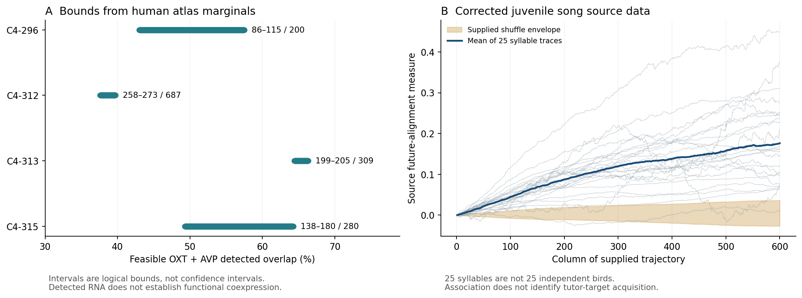

# Learning targets, sensory biases and hypothalamic labels

Research campaign,2026-10-28. Executed under RESEARCH_LAB_CHARTER.md, focused on the active questions in Byrnes's neuroscience to-do list. Seven pilots; two directions received substantive follow-up and adversarial checks. This is a completed bounded campaign, not completion of the entire neuroscience agenda or validation of Byrnes's framework. The previous general campaign is preserved separately.

## What changes the research choice

**The strongest direction is the handoff between choosing a tutor and evaluating practice against a learned target.** Corrected public juvenile-song data reproduce a consistent dopamine quality contrast. Existing intervention studies address acquisition and learning through different pathways. None of our computations identifies how the selected tutor memory becomes the reference used by the later critic. That specific bridge is more useful to investigate than asking whether a generic song/error correlation solves symbol grounding.

**The strongest new calculation is narrower:** in a pinned human hypothalamus atlas cluster, reported OXT/AVP transcript detections require at least199 overlapping observations among309 nuclei, spread across at least three donors. A single donor cannot explain it. But low-abundance transcripts, ambient RNA and doublets remain possible explanations; this is not a newly discovered mixed functional cell type or a human-specific social circuit.



The atlas intervals are exact feasible detection bounds under stated summary-table assumptions, not confidence intervals. The song curves reproduce corrected published summaries;25 syllables are not25 independent birds.

## Portfolio actually tested

| Pilot | Computation/observations | Decision |
|---|---|---|
| Hypothalamus markers | Pinned human/mouse mappings; gene specificity; exact overlap and donor-allocation constraints | **Promoted, narrowed** to candidate nomination and a detection constraint |
| Juvenile song | Corrected trajectory/quality-response tables; unused-panel follow-up; causal counterexample and primary intervention audit | **Promoted**; separate acquisition gate from later evaluation |
| Naive filial approach |197 included chicks/four conditions;86 in key red/yellow comparison; subject bootstrap and occupancy/geometry checks | **Retain sensory bias**, not evidence of a teaching signal |
| Learned filial generalization |63 trained chicks,31 held out; frozen biased/uniform-prior models; independent recovery controls | **Revise**: long exposure weakly discriminates; crucial short condition missing |
| Olfactory route |12 bulb injections,11 clean; piriform positive control; hypothalamic/off-route comparison | **Retire coarse test**: cannot settle sparse OR37 route |
| Interoceptive concept finder |1,800 synthetic fits plus exact second-moment check | **Retain conditional gate constraint**, no human empirical claim |
| Social-value sandbox |66 utilities×351 menus plus magnitude shift | **Retire as novelty lead**, retain explicit coverage example |

[PORTFOLIO.md](PORTFOLIO.md) preserves all11 initial candidates, unrun directions, interpretation changes and allocation decisions. Parameter sweeps, access checks and follow-up controls are not counted as separate pilots. There was no LOOPER continuation in this campaign.

## Promoted result1: song target acquisition is distinct from performance evaluation

From corrected source Fig3 of [Kasdin, Duffy et al.2025](https://doi.org/10.1038/s41586-025-08729-1), the25 supplied syllable trajectories have positive final alignment. Their mean0.17613 reproduces the supplied mean to1.11e−16; shuffled mean0.00442, supplied envelope[−0.02725,0.03609]. Removing any one syllable gives0.16479–0.18302. An independent openpyxl reader confirms the extraction and arithmetic. These are source-summary checks, not raw CCA or shuffle-pipeline reproduction.

The stronger test was frozen before opening unused Fig2 panels. In the published200–300ms window, all25 closer-minus-farther dopamine contrasts are positive, mean0.39143 ΔF/F percentage points, range0.05106–0.96657. Leaving out any syllable gives mean0.36747–0.40561. The ten supplied decile curves decrease in their unlabeled source-column order; two display-time-grid conventions change means by at most1.12e−5. Endpoints reconcile with the paired scalar panel within0.000914, but assigning their quality direction from that match is post-inspection inference, not independently labeled rank validation. The definitive paired scalar contrast is the stronger claim. Independent coordinate-based XML parsing reproduces it. The source's syllable-level t statistic is reproduced only as a reference check; we do not turn it into an independent-animal p-value.

The [2026 correction](https://www.nature.com/articles/s41586-026-10199-y) addresses clipped audio. We use current corrected tables and identify the older manuscript separately. We did not discover the error or independently establish that its raw-data correction is sufficient. The full Fig2 workbook exceeded the bounded-download limit, so only legitimate HTTP206 ZIP members were retrieved and CRC-verified; no whole-workbook hash is claimed.

The adversarial calculation matters because alignment alone is ambiguous. With exploration ε and a pre-existing targetθ, `Cov(ε,−||μ+ε−θ||²)=2σ²(θ−μ)`. A learner driven directly towardθ can therefore move in the direction correlated with an evaluative signal even if its update never reads that signal. Fifty-seed simulations recover this signature; clamping the signal leaves this learner unchanged but stops a signal-dependent positive-control learner. An independent Gaussian moment check agrees within0.000203. This is a counterexample to an inference from one signature, not a fitted alternative to all bird data.

Crucially, causal evidence already exists elsewhere. [Tanaka et al.2018](https://pmc.ncbi.nlm.nih.gov/articles/PMC6219627/) supplies intervention evidence for a PAG→HVC dopamine role during tutoring, including playback pairing. [Hisey et al.2018](https://pubmed.ncbi.nlm.nih.gov/29483664/) manipulates VTA→AreaX/D1 signaling in juvenile copying. The newer natural-development recording addresses later evaluation. The toy counterexample does not rebut those interventions.

**Strongest surviving objection:** the analyzed developmental tables lack bird IDs and raw renditions, and eventual adult song is a proxy for the internal target. They cannot determine how tutor identity is selected, whether a particular tutor memory supplies the later reference, or whether the observed phasic signal causes each natural update. The mechanistic handoff remains an open question, not a demonstrated connection between the two pathways.

Evidence and exact commands: [song notebook](experiments/song_learning/NOTEBOOK.md), [follow-up summary](experiments/song_learning/followup_summary.json), [independent audit](experiments/song_independent_audit.json), [source ledger](experiments/song_learning/SOURCES.md).

## Promoted result2: donor-robust transcript detection does not establish a social cell type

We analyzed public author-derived HYPOMAP tables at commit29599fcb13a74a908c986ad69d68fc3e4a3cf6d0, linked to [Tadross et al.2025](https://doi.org/10.1038/s41586-024-08504-8). The snapshot has415 human granular groups rather than the paper's413; this unresolved version/scope distinction is retained. Raw-cell integration was not rerun. Filtered marker exports cannot show that an unlisted gene is absent.

OXT-named C4-313 has a retained1:1 mouse counterpart at matching correlation0.94356. The two exported OXTR groups have no1:1 counterpart; one is unmatched and one maps many-to-one, with61.1% of its nuclei from one donor. Molecular matching cannot be equated with conserved receptor expression or behavioral function. Reference identity joins and marker-rank sensitivity are saved, including less favorable cases.

For C4-313, the source's rounded marginal fractions imply exactly303 OXT-positive and205 AVP-positive observations among309. Their intersection must contain199–205. The largest donor contributes74; at least125 overlaps must be elsewhere. The two largest donors together contribute143, so at least three donors must contribute. No particular donor's own overlap rate is identified; each can separately have zero in some compatible allocation. This is a constraint on the summaries, not direct joint-cell measurement.

We derived sharp integer bounds, checked an independent four-category donor-allocation MILP, saved attaining allocations, and exhausted52 small known-answer cases. A separate auditor re-parsed original tables without importing the analysis and constructed explicit extreme allocations. Source code supports pooled detection fractions before optional downsampling. Doubled rounding envelopes retain the same relevant counts. The exact exported-object/barcode linkage remains an assumption because acquisition-raw cells were not inspected.

**Strongest surviving objection:** a binary positive RNA call can arise from a tiny minor transcript quantity or contamination. Erasing the observation bound requires at least199 false-positive gene calls or wholly artifactual observations under the specified adversarial model; it does not require64.4% ambient RNA. Rare-cluster artifacts can concentrate. Earlier rat co-detection studies already show that mixed detections can coexist with strongly distinct dominant peptide phenotypes. Neither novelty, peptide release, a new social cell type nor a human–mouse functional difference follows.

Evidence: [atlas notebook](experiments/atlas/NOTEBOOK.md), [integer/donor results](experiments/atlas/followup_summary.json), [independent audit](experiments/audit_atlas/AUDIT.md), [source and contrary-evidence ledger](experiments/atlas/SOURCES.md).

## Useful supporting results and qualified negatives

**Filial sensory bias:** the red-only versus yellow-only large-object comparison gives18.545percentage points difference, subject-bootstrap95% interval[7.43,29.79], across46+40 chicks. The broader four-condition tables include197 chicks. Whole-chick resampling prevents minute-bin pseudoreplication; occupancy weighting preserves the direction. Stimulus area was approximately matched, but contour/numerosity and hue/contrast were not isolated. Supplied tables omit nonapproachers. This is pre-training visual approach, not recognition of an adult or proof that the bias teaches an identity. [Notebook](experiments/imprinting/NOTEBOOK.md).

**Learned generalization:** five-day red/yellow holdouts show no predictive advantage for the fixed biased-prior model over a uniform prior. This does not falsify innate priors: the distinguishing short-exposure condition is missing from the pinned deposit, and known-effect recovery becomes weak at small/noisy sample sizes. Experiment1.zip has Experiment2's declared hash and actual blue-green measurements. The model equations independently reproduce within5.2e−15; this separates weak data discrimination from a broken numerical implementation. No substitute short-versus-long biological result is manufactured.

**Olfaction:** piriform projection recovers in all12 source-selected injections, but hypothalamic densities do not consistently exceed an off-route comparator. The11 cleaner injections still do not guarantee the specialized cells relevant to OR37 tracing. Therefore this is an inadequate decisive test, not evidence that the proposed direct route is absent. [Notebook](experiments/olfaction/NOTEBOOK.md).

**Concept finder:** in the shared-code linear model, decoder gain equals `[πt+(1−π)fρ]/[πt+(1−π)f]`. With genuine teaching fractionπ=.05, sensitivityt=.9 and unrelated imagined labelsρ=0, gain above.9 requires false-update probabilityf<1/190. Exact45-case enumeration and positive-recovery simulations validate the calculation. These are invented regimes, not measured neural rates; favorable high-correlation conditions are retained. [Notebook](experiments/concept_finder/NOTEBOOK.md).

**Sandbox:** ten of66 utility vectors never sacrifice welfare on all351 bounded pair menus. Nine fail when proxy magnitudes increase; pure welfare survives. Exact inequalities reproduce the exhaustive result. This demonstrates why test coverage must specify policy class and feature range; it is neither new general misgeneralization theory nor validation of an AGI system. [Notebook](experiments/sandbox/NOTEBOOK.md).

## What changed, and where attention is valuable

Relative to the broad starting agenda, the campaign identifies useful boundaries: sensory approach is not learned identity; a donor-stable transcript label is not a social algorithm; an evaluative signal is not the origin of its target. These distinctions are supported by calculations and measurement audits, not claims about what the user or Byrnes already knew. The most important correction to our own initial approach was recognizing existing tutoring interventions instead of treating all dopamine evidence as association.

**Recommended next action:** focus on the tutor-memory→critic-reference handoff. First audit whether “adult endpoint approximates the remembered tutor” is justified for the intended experiment. Define a comparison with measured tutor identity/exposure and different predictions for a tutor-specific reference versus generic familiarity/arousal or self-organized maturation. A useful future dataset must preserve bird identity, raw renditions and exposure; more unlabeled recordings would not resolve this uncertainty. The current campaign does not claim such a dataset was found or such an intervention run.

The recommendation would change if the target handoff is already directly demonstrated by stronger primary evidence, or if accessible data cannot distinguish these alternatives. In that case, the atlas provides a concrete secondary project: quantitative joint OXT/AVP detection and artifact checking in C4-313, preferably orthogonal spatial measurements. Audit binary detection versus meaningful expression before spending effort on species-sociality interpretations.

## Reproduction and boundaries

From repository root, using the existing isolated environment:

```sh
.venv/bin/python campaigns/byrnes_todo_2026-10-28/experiments/reproduce.py
```

The runner verifies INPUTS.json, executes all seven pilots, both promoted follow-ups, independent audits and the main figure without network access. REPRODUCTION.json and reproduction/ contain actual exit statuses and logs. requirements-lock.txt records the current Python3.9.6 environment; ordinary scientific dependencies only. For a new environment, use Python3.9 and install that lock into a virtual environment. External platform/version differences may change floating roundoff or solver witnesses; source counts and scientific bounds should agree.

Acquisition is separately documented in each notebook, with URLs, hashes and public access limitations. The Fig2 member acquisition is deliberately partial. Original source workbooks/archives and the previous campaign remain untouched. A fresh download that differs from a pinned hash must be reviewed as a new source version, not silently accepted.

No paid services, compute rental, accounts, external messages, publication, permission changes, controlled human data or private uploads were used. File sizes and aborted downloads are recorded. Open scientific gaps are explicit; none blocks completion of this bounded research campaign. [COMPLETION_AUDIT.md](COMPLETION_AUDIT.md) maps the charter requirements to inspected evidence.
