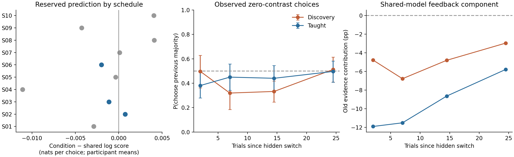

# Learning routes and later responses to hidden probability changes

2026-10-28 · Completed public human IBL reanalysis · Protected participant/schedule evaluation

## Finding

**A shared target-history model predicted reserved choices well; adding teaching-condition differences to its history updating did not improve prediction. This does not establish equivalent adaptation.**

On 39 reserved participants, including 25 on three completely withheld schedules, adding condition-specific history weights changed the primary log score by **−0.00105 nats per choice** (95% participant-bootstrap interval **−0.00291 to +0.00072**). Shared history improved on the matched response-persistence baseline by **+0.03396** (**+0.02457 to +0.04306**), with positive gains on all ten evaluated schedules.

The fitted condition contrast was **+2.92 percentage points** in standardized old-context choice probability, with a conditional refit interval **−1.19 to +7.70 points**. That crosses the prespecified +5-point boundary. Known-effect tests also failed the equivalence gate before validation: genuine five-point differences were sometimes attenuated, missed, or assigned falsely narrow intervals. The warranted conclusion is transferable predictive history structure with **no demonstrated incremental condition-specific updating**, and a measured limitation on distinguishing a shared account from modest persistent differences.

The fitted longer-history component is **repulsive**: it pushes choices away from the previous context. It must not automatically be described as preserving an old Bayesian prior or as feedback-specific learning.

## Protected empirical comparison

The release contains 80 complete sessions: 39 taught and 41 discovery, each with 600 trials. We used every released participant, without accuracy matching or performance exclusions. Authors had already excluded incomplete, pilot and repeat sessions. The 134,562,545-byte CSV matches its published MD5. Independent reconstruction matches all 80 input arrays to ten pinned task schedules; exported participant 042 uses sequence 1 after an author ID rename.

Inputs and metadata alone determined the split, using PCG64 seed 20261028:

| Partition | Discovery | Taught | Schedules |
|---|---:|---:|---:|
| Development | 22 | 19 | 7 |
| Reserved people, familiar schedules | 7 | 7 | 7 |
| Reserved people, entirely unseen schedules | 12 | 13 | 3 |

The historically inspected prefix participant 006 remained in development. Downloading preceded splitting; reserved response fields were skipped without analysis. Final code/protocol hashes were frozen at **21:00:37 UTC**, and reserved responses first extracted at **21:00:39 UTC**. Population fitting used development people only. Reserved first-200-trial behavior was permitted calibration; their later responses never refit population or individual parameters. This was a prospective internal freeze, not external preregistration. See [split](protocol/SPLIT_LOCK.json), [freeze](protocol/FINAL_FREEZE.json), [opening record](protocol/VALIDATION_OPENED.json) and [amendments](protocol/AMENDMENTS.md).

The primary endpoint was a responding choice at contrast 0 or 0.1 in the first 30 trials after a hidden 0.2↔0.8 switch beginning during trials 201–600. Initial unbiased-to-biased transitions were excluded. There were **2,895 opportunities and 2,867 responses**, from all 39 reserved people; 28 omissions remained in coverage summaries. Participants, not individual trials, are the biological units.

| Reserved prediction contrast | All 39 people | Familiar schedules, 14 people | Unseen schedules, 25 people |
|---|---:|---:|---:|
| Condition-history minus shared | −0.00105 [−0.00291, +0.00072] | −0.00148 [−0.00438, +0.00113] | −0.00081 [−0.00325, +0.00164] |
| Shared minus response-persistence baseline | +0.03396 [+0.02457, +0.04306] | +0.03467 [+0.01561, +0.05276] | +0.03356 [+0.02353, +0.04388] |

Entries are equal-person mean log-score differences, nats/choice, with 95% paired participant-bootstrap intervals. The baseline already includes previous choice, condition-specific sensory/time/response terms, early calibration and individual variation.

The Brier improvement from condition-specific history was −0.00056 [−0.00148, +0.00029]. A two-stage schedule/person bootstrap gave a log-score interval of −0.00348 to +0.00134. Removing any single schedule left the condition-history mean negative. Only three schedules were entirely unseen, limiting unrestricted schedule-population inference. [Participant scores](outputs/primary/participant_scores.csv), [schedule scores](outputs/primary/schedule_scores.csv), [all predictions](outputs/primary/trial_predictions.csv), [summary](outputs/primary/summary.json).

Blue points in the left panel denote entirely withheld schedules. Middle-panel intervals resample participants. The right panel is a model diagnostic without a sampling interval, not independent observation of memory or a direct teaching effect.

## What the models compare

Both models receive identical nuisance information and regularization: intercept, four signed contrast-level coefficients, previous choice, later time and sensory-sign×time; condition interactions with these nuisance terms; and common relationships between early calibration and later nuisance/history coefficients. Calibration consists of sensory-choice association in trials 1–100 and 101–200, response bias and omission fraction in trials 1–200. These are noisy summaries, not error-free latent skill.

The shared model adds causal exponentially weighted histories with fixed time constants 2, 8 and 32 trials. Evidence after a valid response is choice×signed correctness; omission supplies no revealed-side information. Both allow individual random intercept, sensory-sign and three history coefficients. The alternative adds only three condition×history coefficients: shared and alternative have 63 and 66 fixed coefficients. **Both already know condition for nuisance prediction**. The result concerns additional condition dependence of history updating, not absence of all later condition differences.

New-person predictions condition on early summaries and integrate the same fixed Gaussian residual distribution with 20-node quadrature. This is regularized joint-mode prediction, not a Bayes factor, a full hierarchical posterior or an identified neural learning rate. Contrast-specific sensory coefficients accommodate sensitivity and saturation empirically; literal lapse rates are not identified. Fixed residual SD is 0.7, ordinary fixed-effect prior SD 2, intercept SD 3 and calibration/condition-history interaction SD 1. Optimization requires maximum absolute gradient below 0.001. [Full frozen methods](protocol/FINAL_PROTOCOL.md), [implementation](experiments/model.py).

Hidden block labels and switch offsets define evaluation only. They never enter the ordinary predictor. Current contrast is visible; current target side at zero contrast and current/future feedback are not supplied. Independent future-blindness and hidden-label tests passed. The timescales are fixed basis functions, not recovered physiological constants.

## Observable time course and old-context influence

Zero contrast means equal pedestal gratings, not an empty display. There were **871 responding zero-contrast trials** in the primary windows:

| Trials since switch | Discovery: P(old-majority choice) | Taught |
|---|---:|---:|
| 0–4 | 0.497 [0.362, 0.628] | 0.381 [0.280, 0.490] |
| 5–9 | 0.319 [0.185, 0.459] | 0.450 [0.342, 0.558] |
| 10–19 | 0.333 [0.245, 0.418] | 0.440 [0.333, 0.545] |
| 20–29 | 0.513 [0.410, 0.614] | 0.496 [0.408, 0.581] |

These descriptive curves have broad participant uncertainty and different histories across bins. Zero-contrast preswitch means over the preceding ten trials were 0.522 and 0.413. Mixed 0/0.1 curves also contain immediate sensory evidence and cannot be read as pure beliefs. [Curves/denominators](outputs/primary/observable_curves.csv), [preswitch data](outputs/diagnostics/preswitch_reference_rows.csv).

The shared population history coefficients were +0.735, −0.361 and −1.062 for the 2-, 8- and 32-trial traces. A prespecified diagnostic removed their pre-switch contributions while holding subsequent evidence and lagged choices fixed, at zero current contrast. The old-majority-aligned contribution was **−4.78 points for discovery and −11.91 for taught people in trials 0–4**, attenuating to **−2.96 and −5.79 points in trials 20–29**. These components use each group's reference covariates: a shared calibration/history relationship can produce group differences. They are not direct teaching effects. The negative sign describes repulsion, not perseverance of an old prior. [Diagnostic table](outputs/primary/shared_old_context_component.csv).

Visual exposure, revealed target side and feedback are correlated. Choices alone do not identify sensory adaptation, a decision strategy, reward learning or internal probability representation. Cursor endpoints partly define choices and cannot independently confirm a choice-derived effect.

## Practical contrast and robustness

The predeclared meaningful difference was five percentage points in zero-current-contrast old-majority choice probability over the first 20 post-switch trials. Standardization changes only condition-history terms while keeping reference histories, calibration and nuisance features fixed. The signed mean was **+2.92 points**, RMS **5.01**; four post-switch-bin means were −0.24, +3.50, +4.29 and +4.66 points. RMS exposes cancellation but has no separately declared equivalence threshold.

Five hundred whole-development-person bootstrap refits gave **[−1.19, +7.70] points**. Duplicate draws received separate participant identities. Reference validation histories remained fixed, so this is conditional model uncertainty. It neither meets ±5-point equivalence nor has recovery coverage adequate for a biological bound.

Every prespecified sensitivity retained a negative point estimate for added condition-history prediction:

| Sensitivity | Condition minus shared log score |
|---|---:|
| Random-effect SD 0.35 / 1.4 | −0.00203 / −0.00027 |
| Wider condition-history prior SD 3 | −0.00118 |
| Exclude 006/009/010 | −0.00088 |
| Common calendar-date support | −0.00051 |
| Train/evaluate trials 301–600 | −0.00153 |
| Asymmetric sensory saturation | −0.00097 |
| Zero contrast / all later responses | −0.00275 / −0.00081 |
| Equal schedule×condition weighting | −0.00126 |
| Elapsed-time history | −0.00082 |
| Explicit fixed-lapse probes | −0.00107 to −0.00137 |

Lapse-mixture probes gave both models the same discovery/taught rates: 0.002/0.002, 0.10/0.002 and 0.25/0.002. They shifted the standardized contrast from **2.97 to 5.63 points**, while condition-history terms still failed to improve prediction. These are sensitivity assumptions, not estimated rates. The strongest discovery-lapse probe improved the shared primary-window score from −0.63260 to −0.62875 but worsened the all-later score from −0.42707 to −0.43057; no winning floor was selected on validation.

Elapsed-time histories address response and feedback duration: correct/error feedback lasts 1/2 seconds. Fixed scales selected from development were 5.07, 20.27 and 81.10 seconds. Results persist under this representation without identifying a memory constant. [Sensitivity table](outputs/sensitivities/summary.csv), [lapse results](outputs/lapse_challenge/summary.csv), [absolute scores](outputs/lapse_challenge/absolute_predictive_scores.csv), [elapsed-time results](outputs/time_history/summary.json).

Accuracy did not fully converge. Reserved later-trial equal-person accuracy was **76.5% discovery versus 80.1% taught**; maximum-contrast accuracy was **91.8% versus 99.4%**. Response rates were 98.24% and 99.98%. These differences were retained, not matched away. Primary omissions numbered 27 and 1. Extreme assignments of omitted old-context responses change discovery-bin raw means by at most 2.4 points; this does not impute binary prediction scores. [Coverage](outputs/diagnostics/condition_coverage_performance.csv), [omission bounds](outputs/diagnostics/omission_worst_case_curve.csv).

## Scientific recovery and discrimination

Before validation, **600 actual-schedule simulations and 5,500 bootstrap refits** tested heterogeneous people/schedules, sensory/lapse/motor and acquisition differences, a common latent-skill/history law, nonstationarity, and both signs and shapes of persistent change. All fits passed convergence checks.

| Simulated account | True mean contrast | Estimated mean | Positive score detection |
|---|---:|---:|---:|
| Shared, nuisance differences | 0 points | +0.90 | 5/100 |
| Shared, latent-skill carryover | 0 | +0.91 | 3/100 |
| Added slow-history component | +5.00 | +4.81 | 48/100 |
| Fast-to-slow redistribution | +4.98 | +4.64 | 18/100 |
| Larger slow-history component | +9.97 | +7.98 | 94/100 |
| Opposite slow-history difference | −5.00 | −2.71 | 26/100 |

Detection requires the participant score interval to exceed zero. Nominal 95% effect-interval coverage was 75–90% across the 20-replicate nested cells and 70% in the 10-replicate negative-effect cell. Two of 20 positive-five-point and two of ten negative-five-point cases falsely placed the entire interval inside ±5 despite realized truth beyond the margin. Small nested denominators make error-rate estimates imprecise; they nevertheless demonstrate unsafe equivalence. The original margin was never widened.

An independent 30-replicate calibration challenge separated proxy bias and shrinkage. Under a shared latent-skill law, original early summaries produced a +1.16-point mean apparent direct contrast. Oracle skill reduced it to +0.03, but true ±5-point effects still shrank to roughly ±3.6–3.7. A wider prior improved recovery to +4.36/−4.19. Rescaling early summaries or estimating early psychometric slopes did not consistently solve it. Positive recovery can look good because proxy bias cancels shrinkage; the opposite-sign control reveals the problem. [Recovery report](outputs/recovery/RECOVERY_REPORT.md), [replicates](outputs/recovery/final/replicates.csv), [calibration diagnosis](experiments/design_audit/CALIBRATION_CHALLENGE_REPORT.md).

These rates are **generator-conditioned**, not universal empirical-task power. The initial generator had attractive sustained history and noisier taught high-contrast behavior than development data. After validation, a single development-anchored **repulsive-baseline audit** therefore tested another 400 synthetic datasets without changing models, windows or real-data fits. Detection was **1/100 under the shared null, 44/100 for +5 slow history, 47/100 for −5 slow history and 23/100 for +5 redistribution**. True −5.02 points again averaged only −2.70 after fitting. The null generator's total history contribution aligned with the old majority was −8.83 points, confirming the repulsive regime. That total-history removal differs from the human diagnostic removing only pre-switch traces. The qualitative five-point limitation survives, while exact power changes. This supplementary audit is explicitly post-validation. [Report](outputs/repulsive_recovery/REPORT.md), [results](outputs/repulsive_recovery/supplementary/summary.json).

The prespecified two-summary compatibility diagnostic retained the shared-carryover and both positive-five-point populations at its 0.05 threshold; the tested ten-point slow and negative-five-point populations were not retained. This is a discrete comparison within the original synthetic families, not a posterior, continuous confidence interval or general exclusion of all changes with those magnitudes. Their different baseline history pattern further limits interpretation. [Diagnostic](outputs/simulation_compatibility/discrete_accounts.csv).

## Additional observations: what was actually tested

More of the same data is not yet a validated prescription. We simulated 160/320 independent people on the same ten schedules, with original calibration or 800 extra idealized independent sensory decisions per person plus a wider history-effect prior. At 320 people, the combined procedure detected the two five-point signs in 100% and 93% of 30 simulations overall. However, it selected condition dependence in **5/30 shared-law nulls**, and only **22/30 negative-effect datasets** succeeded on entirely unseen schedules. No tested design met balanced 80% unseen-schedule detection with controlled null behavior. These additional-observation tests use the original generator and establish no universal required sample size. [Experiment and exact counts](experiments/design_audit/SAMPLE_SIZE_CHALLENGE_REPORT.md).

The needed observation is **independent, stable sensory/lapse calibration plus new, balanced stimulus schedules**, not extra cursor endpoints or an accuracy-matched subset. The estimator must also jointly model calibration measurement error and the shared skill/history relationship; condition can otherwise serve as a proxy for incompletely measured skill. A future causal comparison additionally requires randomized teaching and documented protocol/assistance. My next research decision is to validate that joint measurement model before recommending collection or asserting a sufficient participant count. No successor campaign or collection has been launched.

This is a demonstrated limitation of the tested prediction/measurement procedure. It does not prove that no better analysis of these data could discriminate the accounts.

## Source limits, verification and reproduction

Teaching bundled rules, examples and five practice trials; it did not reveal probability blocks. Allocation followed an ID rule with three early discovery exceptions, not randomization. Public history cannot establish the exact builder for each early October session. Participant 006 was manually stopped and truncated to 600 trials by the authors. Date/exclusion checks do not make the comparison causal. This result concerns later behavior in one session, not retention, neural storage or education.

Full primary-manuscript HTML/JATS remained inaccessible through legitimate routes (HTTP429). We inspected primary API metadata, pinned task/analysis code and close prior work. Existing papers already establish history dependence, heterogeneous learning trajectories and individual differences. No exact protected comparison was found in inspected code; exhaustive novelty remains unverified. [Sources](SOURCES.md), [source audit](experiments/source_audit/AUDIT.md).

Two independent implementations reconstructed the results from original bytes. One reproduced every reserved probability for 23,400 rows and three models without importing primary feature/model code: maximum error **5.6×10⁻¹⁶**. Another independently reconstructed masks, scalar scores, all participant/schedule summaries and curves. All responding feedback-side identities passed. Extraction correctness does not repair scientific recovery failure. [Probability audit](experiments/design_audit/independent_validation_audit.json), [score audit](experiments/source_audit/independent_score_results.json), [adversarial review](experiments/design_audit/ADVERSARIAL_RESULT_AUDIT.md).

Offline replays reproduced every primary prediction, all 500 effect-bootstrap draws, every prespecified sensitivity and 20 control datasets with **zero numerical difference**. Inputs, code snapshots, numeric tables, figures, seeds and failure records are preserved. Dependencies: Python 3.9.6, NumPy 2.0.2, SciPy 1.13.1, pandas 2.3.3, Matplotlib 3.9.4, openpyxl 3.1.5. From the repository root:

    # Primary empirical analysis, sensitivities, independent audits and 20 controls
    .venv/bin/python campaigns/human_learning_routes_2026-10-28/experiments/reproduce.py

    # Also repeat complete main recovery, calibration and additional-observation studies
    .venv/bin/python campaigns/human_learning_routes_2026-10-28/experiments/reproduce.py --full

Replays use new output directories and preserve original results. Full mode includes both main and supplementary recovery families. [Primary replay](outputs/reproduction/verified_offline/reproduction_result.json), [sensitivity replay](outputs/reproduction/verified_offline/sensitivity_reproduction_result.json), [repulsive-control replay](outputs/reproduction/verified_offline/repulsive_reproduction_result.json), [dependency lock](requirements-lock.txt), [environment](logs/environment.json), [completion audit](COMPLETION_AUDIT.md).
