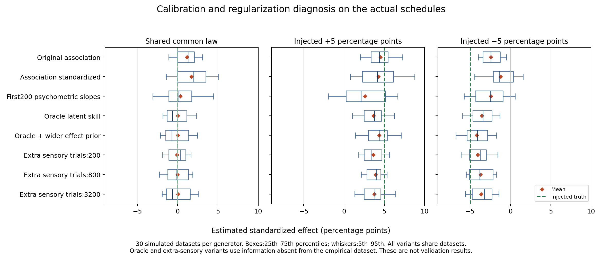

# Calibration improvements do not by themselves validate five-point equivalence

2026-10-28. All results here are simulations on the actual schedules and locked participant/schedule split. No real validation responses were opened. Ninety independently generated datasets (30 per scenario) were analyzed under eight calibration variants, yielding1,440 converged shared/condition model fits. The variants and independent seeds were specified before the diagnostic run; a two-replicate smoke run was followed by the complete30-replicate run.

## Finding

The original early-accuracy summaries leave some condition association acting as a proxy for a shared latent skill/history relationship. Supplying the true latent skill removes that null bias. However, oracle calibration then reveals attenuation of both positive and negative effects. Widening the group-history prior reduces this attenuation without eliminating it. Simple realistic replacements using only the existing first200 trials do not solve both sides of the problem.

The practical implication is to retain the primary model as a limited predictive comparison and require calibrated uncertainty before any equivalence claim. Near-unbiased recovery of a positive effect alone is misleading here: positive proxy bias partly offsets regularization/model attenuation, while the negative effect exposes both biases in the same direction.

## Quantitative comparison

Numbers are mean estimated standardized effects in percentage points. Actual mean injected effects were0,+5.007 and−4.982 points. “Oracle” and extra sensory observations are unavailable in the empirical dataset.

| Calibration variant | Shared common law | Injected +5 points | Injected −5 points |
|---|---:|---:|---:|
| Original association summaries | +1.16 | +4.52 | −2.42 |
| Same summaries, development-SD scaled | +1.71 | +4.29 | −1.19 |
| First/second100 psychometric slopes | +0.34 | +2.60 | −2.42 |
| Oracle latent skill | +0.03 | +3.68 | −3.55 |
| Oracle skill, condition-history priorSD3 | +0.04 | +4.36 | −4.19 |
| Extra independent sensory200 | −0.07 | +3.63 | −4.04 |
| Extra independent sensory800 | −0.00 | +3.92 | −3.71 |
| Extra independent sensory3200 | +0.05 | +3.76 | −3.64 |

Oracle skill therefore removes the original null bias of1.16 points but leaves positive/negative attenuation of1.33/1.43 points. Increasing only the effect priorSD from1 to3 reduces those remaining biases to0.65/0.79 points. This is evidence that sensory measurement error is not the only limitation. It does not isolate regularization from the remaining likelihood mismatch and finite-participant variation.

Across replicates, standard deviations of the estimates are roughly1.4–2.9 points depending on variant/scenario. These are sampling distributions of the estimator in the synthetic experiment, not uncertainty intervals for an empirical effect. The diagnostic does not establish confidence-interval coverage; main nested recovery remains the relevant gate.



## The additional-observation test

Extra independent sensory observations improve the pooled correlation between estimated and true shared latent skill from roughly0.69 at200 trials to0.89 at800 and0.97 at3200. The generator assumes a fully acquired sensory task, known lapse, equal signed-contrast allocation and no history influence. Bias and sensitivity are fitted jointly. This is an optimistic information experiment; ordinary task observations with unknown lapse/history would contain less clean sensory information.

Despite near-oracle measurement at3200, the five-point effects remain attenuated by about1.2–1.3 points, similar to the oracle model with the original prior. No tested number of extra sensory observations alone solves the full discrimination criterion. Increasing the number of independent participants and estimating the effect with a scientifically calibrated procedure is a separate needed design axis. More people on the same schedules would still leave uncertainty about transfer beyond the three unseen schedules.

Predictive-score detection is also not a monotone measure of calibration quality. For example, the extra200 version detects27/30 positive injections, but also favors the condition model in4/30 shared-law null datasets; the original version detects12/30 positives and11/30 negatives with0/30 null detections in this diagnostic. The oracle version detects18/30 positives and16/30 negatives with0/30 null detections. Thirty simulations give coarse rate estimates, and none of these counts establishes a reliable80% detection guarantee for both signs.

## Recommendation for the main campaign

- Do not replace the primary calibration with simple z-scaling or the tested first200 psychometric summary: neither improves null behavior and both signed-effect recovery together.
- Do not infer shared adaptation from a bootstrap interval inside±5 points unless recovery demonstrates the interval's coverage and protects against false equivalence.
- Keep nuisance adjustment described as adjustment for observed early proxies, not perfect adjustment for latent acquired skill.
- If equivalence fails its calibration gate, compare the empirical statistic with the saved null and signed-effect recovery distributions to state which tested accounts remain compatible. Such simulation inversion is conditional on the tested generators, not a broad population guarantee.
- Treat an independent well-learned sensory measurement plus additional biological and schedule replication as distinct requirements. The present diagnostic shows why merely adding more calibration trials is insufficient.

## Reproduction and provenance

Run from the repository root:

```sh
.venv/bin/python campaigns/human_learning_routes_2026-10-28/experiments/design_audit/calibration_challenge.py --reps 30 --workers 2 --label calibration_reproduction
.venv/bin/python campaigns/human_learning_routes_2026-10-28/experiments/design_audit/plot_calibration_challenge.py --label calibration_reproduction
```

Inputs/scales/hashes/seeds are in `calibration_challenge/manifest.json`. Per-replicate results are in `calibration_challenge/replicates.csv`; all scenario/variant summaries are in `calibration_challenge/summary.csv`. The preserved smoke run is in `calibration_smoke/`. Code and assumptions are recorded in `CALIBRATION_CHALLENGE_PLAN.md` and `calibration_challenge.py`. The static figure is available as PNG and PDF. This work changes no primary model, protocol or empirical data file.
