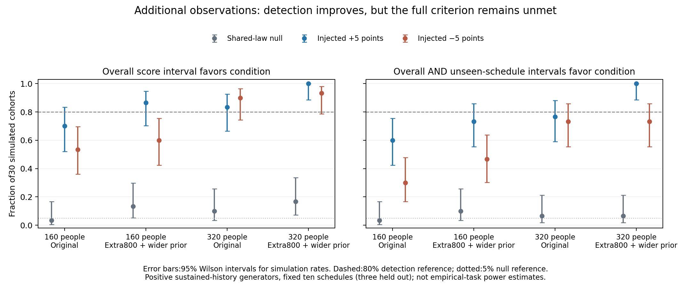

# The tested320-person design improves detection but is not yet adequate

2026-10-28. Completed180 independently generated task cohorts: two sizes×three generators×30 replicates. Each cohort was analyzed with two specified procedures, giving720 converged fits. Every person has independently simulated latent effects, choices, omissions and feedback; only stimulus schedules and condition/split proportions were replicated. No empirical response data entered this experiment.

## Concrete result

Quadrupling the cohort to320 people and adding800 idealized independent sensory observations per person raises overall detection of five-point effects to30/30 for the positive injection and28/30 for the negative injection. However, only22/30 negative injections generalize with a positive score interval on the unseen schedules, and the condition model wins5/30 shared-law null datasets on the overall score. The tested design therefore does **not** establish at least80% detection across held-out schedules with well-controlled false interpretation of a direct condition effect.

The original procedure gains precision with more people but retains substantial bias. At320, its mean estimated effect is+1.64 points in the shared-law null and−2.49 points when the true direct effect is approximately−5 points. Additional people alone do not repair the nuisance-measurement/model limitation.

## Detection results

“Both” requires overall and unseen-schedule score intervals to favor the condition-dependent model. Percentages are counts out of30 synthetic cohorts, not guarantees for a future experiment.

| People | Procedure | Null overall | +5 overall | −5 overall | +5 both | −5 both |
|---:|---|---:|---:|---:|---:|---:|
| 160 | Original | 1/30 (3%) | 21/30 (70%) | 16/30 (53%) | 18/30 (60%) | 9/30 (30%) |
| 160 | Extra800 sensory + priorSD3 | 4/30 (13%) | 26/30 (87%) | 18/30 (60%) | 22/30 (73%) | 14/30 (47%) |
| 320 | Original | 3/30 (10%) | 25/30 (83%) | 27/30 (90%) | 23/30 (77%) | 22/30 (73%) |
| 320 | Extra800 sensory + priorSD3 | 5/30 (17%) | 30/30 (100%) | 28/30 (93%) | 30/30 (100%) | 22/30 (73%) |

At320 with the combined procedure, the95% Wilson interval for overall positive detection is88.6–100%; for negative detection it is78.7–98.2%; for null selection it is7.3–33.6%. The negative unseen-schedule rate of73.3% remains below the80% target even as a point estimate. Null selection requiring **both** overall and unseen evidence is2/30 for each320-person procedure; that count is too small to establish a tightly controlled rate.



## Effect bias

Mean estimated standardized effects, in percentage points:

| People | Procedure | Null | True +5 | True −5 |
|---:|---|---:|---:|---:|
| 160 | Original | +1.36 | +5.54 | −2.62 |
| 160 | Extra800 + priorSD3 | −0.36 | +4.45 | −4.43 |
| 320 | Original | +1.64 | +5.97 | −2.49 |
| 320 | Extra800 + priorSD3 | +0.02 | +4.63 | −4.39 |

The combined observation/estimation procedure reduces mean effect bias. This does not automatically calibrate its predictive score test. When sensory skill is measured imperfectly, condition can still help infer latent skill under a **shared** skill-to-history relationship. The fitted model treats the calibration summary as known; a latent measurement model would instead account for its uncertainty and the condition-dependent sensory distribution in both accounts. The shared-law null results show why a predictive gain alone would not isolate a route-specific updating mechanism.

## Exact scope and cost

The160-person design has82 development and78 validation people; the320-person design has164 and156. The combined design adds800 fully learned sensory-only choices to each person's600-task-trial session, requiring224,000 or448,000 decisions across the cohort. Extra sensory choices assume known lapse, equal signed contrasts, no history effects and joint estimation of bias/sensitivity. That is an optimistic observation design, not simply800 more ordinary serial task trials.

Both sizes reuse ten observed schedules, including the same three entirely held-out schedules. Condition proportions and schedule imbalance are preserved. More people here do not provide new schedule coverage or randomized teaching assignment. These are simulated new cohorts, not predictions conditional on appending observations to the actual fixed80 people.

The generators have positive sustained-history influence. After the primary validation opened, the empirical model showed a repulsive long-history association. Consequently these rates must be described as **conditional stress-test results**, not measured power for the observed human response regime. A repulsive-baseline recovery check is appropriate before making stronger task-specific design claims.

## Recommendation

Do not promise that160 or320 people, or800 extra sensory trials, will resolve the empirical question. The320-person combined design is an informative tested improvement but fails the full criterion. A better future design needs new schedules balanced across conditions and repeated independent sensory measurements analyzed with a measurement-error-aware common-law model; those changes require their own recovery study. The present campaign supplies measured limits and rejects a simplistic “just collect more people” prescription, without inventing an untested sufficient sample size.

## Reproduce

```sh
.venv/bin/python campaigns/human_learning_routes_2026-10-28/experiments/design_audit/sample_size_challenge.py --reps 30 --workers 2 --label sample_size_reproduction
.venv/bin/python campaigns/human_learning_routes_2026-10-28/experiments/design_audit/plot_sample_size_challenge.py --label sample_size_reproduction
```

See `sample_size_challenge/manifest.json` for exact seeds, generator scales and source hashes; `replicates.csv` for all360 procedure/cohort results; `summary.csv` for rates, effect bias and Wilson intervals. The one-replicate implementation check remains in `sample_size_smoke/`. No primary model or validation outcome was changed.

Provenance note: the recovery module's source hash changed during the run because its owner added plotting and corrected separate interval-reporting flags. The simulator, input loader and score function used here were unchanged. The mismatch is retained in `completion_manifest.json`; current-source reruns of the160-person null and320-person negative-effect smoke cohorts reproduce both procedures within9.4e-17 on numeric outputs. This check verifies that the reporting-only source change did not change this experiment's numerical procedure.
