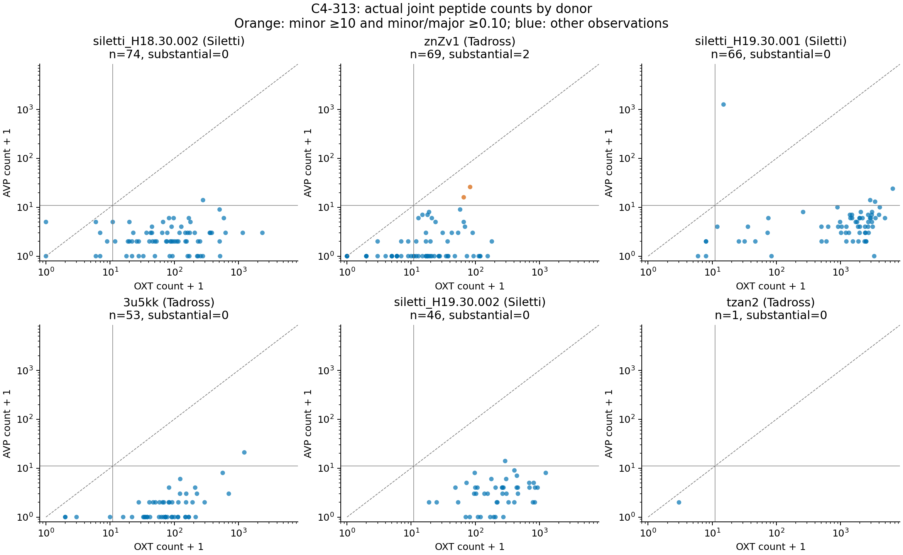

# C4-313 is predominantly an unequal peptide-transcript population

2026-10-28. Focused quantitative follow-through to the approved HYPOMAP study. **Decision: deprioritize C4-313 as a candidate for a substantial mixed OXT/AVP state.** The observed co-detections are predominantly trace secondary counts. This does not establish that those small counts are all ambient, that low-level biological co-transcription is absent, or that no rare mixed cells exist.

Status: **completed**. Quantitative extraction, nuisance sensitivities, known-effect/null/doublet controls, adversarial independent reproduction and the full offline reproduction script have all run successfully. The auxiliary mixture model's failed severe-noise positive control is retained as a scientific limitation.

## The measurement that changed the decision

The old summaries required199–205 joint detections among309 nuclei. Direct extraction finds **204**, reproducing OXT-positive303 and AVP-positive205 exactly. But **195 of204 joint detections (95.6%) have fewer than10 secondary counts**. The median minor count is1 across all309 cells and2 among joint-positive cells. Median minor/major ratio is0.00330 overall and0.0123 among joint-positive cells. In302 nuclei OXT is larger, two are AVP-dominant, and five have neither detected.

The frozen primary definition required both genes≥10 counts and minor/major≥0.10. Only **2/309 (0.65%)** qualify: OXT/AVP82/25 and65/15, both in donor `znZv1`, sample `znZv1_S1`. Both also pass the supplementary one-per-thousand depth criterion using either actual or metadata total counts. There are **zero primary-qualified cells among186 Siletti observations**. Raising the minimum to20 leaves one cell. Relaxing it to5 while retaining the10% ratio yields eight, all from the same donor. Merely requiring10 secondary counts regardless of relative abundance finds9/309, including strongly unequal profiles such as6528/23.

| Source | Donor | N | Both detected | Median minor count | Median minor/major | Primary substantial |
|---|---|---:|---:|---:|---:|---:|
| Siletti | H18.30.002 |74|56|1|0.01156|0|
| Siletti | H19.30.001 |66|62|3|0.00220|0|
| Siletti | H19.30.002 |46|38|2|0.00668|0|
| Tadross | 3u5kk |53|23|0|0|0|
| Tadross | znZv1 |69|24|0|0|2|
| Tadross | tzan2 |1|1|1|0.50|0|

The one-cell donor cannot establish replication. The other five are the useful donor groups; eleven is the whole-atlas donor count. Donors, studies and cells are not interchangeable replicates.



The [primary table](outputs/abundance/primary_table.csv), [all per-cell target observations](outputs/abundance/candidate_per_cell.csv), [donor quantiles](outputs/abundance/donor_abundance.csv), [complete threshold grid](outputs/abundance/threshold_grid.csv) and [survival/ratio curves](outputs/abundance/abundance_curves.png) preserve every declared threshold rather than selecting a favorable cutoff. The primary definition is an operational count-scale criterion, not a translation or physiological threshold. Even the looser5-count/1% criterion finds26 cells; this low-level unequal tail is retained, not declared biologically meaningless.

## What was acquired and verified

The public version contains the same309-cell C4-313 size, named population and donor/study capacities as the old snapshot. All415 neuronal C4 names and sizes match the pinned author table. The current452 label values additionally contain37 inherited non-neuronal C3 groups. This does not resolve the paper's separate413-cluster cross-species scope or prove historical barcode equality without its missing barcode roster.

We extracted **23,512×36,924 sparse counts**: all12,539 Mid-3 cells, the four peptide populations, and metadata-selected broader neuronal/non-neuronal controls. Inputs preserve barcodes, original row/column indices, donors, samples, studies, regions, original QC and actual count totals. All85,585,956 stored nonzeros are finite positive integers represented as float32; no rounding was used. Gene mapping is unique: OXT ENSG00000101405 and AVP ENSG00000101200. No global is_primary_data filter discarded Siletti.

The acquisition retained3.278GB of verified original HTTP206 ranges from the5.231GB asset, including an explicitly recorded inefficient metadata traversal. Each range has offsets, headers and SHA256. All272,352 earlier review bytes match the current overlaps. The whole asset was not downloaded and has no claimed whole-file digest. See [PROVENANCE.md](PROVENANCE.md), [input manifest](inputs/acquisition_manifest.json) and the two protected sparse subset manifests.

`raw.X` is processed count data. CellBender is documented for Tadross; HYPOMAP imported already processed Siletti through another path. We did not infer identical correction or absence of residual contamination. Source code plus numerical reconstruction also exposed **mixed mitochondrial units**: Tadross exports a percentage, Siletti a fraction. The new analysis recomputes MT-gene fractions and uses within-donor QC ranks. Actual extracted totals are2.4–8.1% below metadata totals in the peptide subset. Six normalized-X checks match log1p(10000×raw/metadata_total) to <2.4×10⁻⁷, supporting an older larger feature universe, but the exact later feature-removal step remains unknown. OXT/AVP relative ratios do not depend on this total-depth discrepancy.

## Robustness and competing technical explanations

The primary result is not produced by excluding quality outliers: it already holds with every target observation. Removing each donor's top10% actual depth retains only one primary-qualified cell overall. Using joint top5% filters for actual depth/features/mitochondrial fraction against the full donor Mid-3 reference also retains one. Metadata-neuronal QC ranks give the same one-case outcome. [Quality/depth tables](outputs/abundance/quality_depth_sensitivity.csv) and [within-donor associations](outputs/abundance/within_donor_correlations.csv) retain every donor and sensitivity. Binomial thinning to expected total depths1000,3000 and3061.2 did not reveal a recurrent substantial tail; the count threshold loses sensitivity at these depths. Thinning is an assay-depth sensitivity, not a decontamination method.

The prespecified other peptide populations have primary-qualified observations too: C4-2968/200, C4-31229/687, C4-3159/280. Their maximum secondary counts are95,406 and30 respectively, versus25 in C4-313. These comparisons confirm that the extraction does not mechanically restrict the second gene to tiny values. They are selected neighboring populations and are not new, independently validated mixed cell types.

**Empirical background readily spans the two rare cases.** Conditional overdispersed count models using donor/depth-matched mean rates predict11.75 primary-qualified cells from nearby Mid-3 controls,2.15 from broader neurons, or1.02 from non-neuronal controls, versus2 observed. Poisson versions range0.020–22.09, demonstrating sensitivity to heterogeneity and pool choice. The complete1/2/5/10/20× nuisance grid is retained. These pools contain genuine expression and do not estimate or bound the true ambient fraction.

The post-outcome sample-local check is more specific. In `znZv1_S1`,194 nearby neurons,129 broader neurons and29 non-neuronal cells imply AVP counts35.47/23.61/28.93 at the first case's depth and11.06/7.36/9.02 at the second, compared with observed25 and15. The29 non-neuronal controls contain86 AVP counts over34,756 non-peptide counts. This provides a serious residual-background explanation without proving it. The two cases have ordinary non-peptide complexity relative to matched nearby neurons (45th and33rd percentiles), so an obvious high-complexity-doublet explanation also cannot simply be asserted.

**The auxiliary mixture model is informative about its own limits.** The regularized trace model allows source/gene background, depth dependence, low-level dominant-linked signal and overdispersion. Its alternative adds a mixed component. Both condition explicitly on observed major counts and gene orientation, with correct count truncation; preprocessing/rates/parameters use training donors. Nearby-pool held-out log-score gains for mixing are+4.80,+13.57,+5.82,−17.55,+96.95 across the five useful donors, with the large gain in znZv1. Its two primary-qualified cases contribute+48.07; six observations with only5–8 minor counts contribute+46.02. Signs change in other donors under different control pools. This is an improved conditional fit to a source/sample-sensitive tail, not a recovered biological mixed population.

Crucially, the full model pipeline **fails known-effect recovery under severe empirically motivated overdispersion**: null and injected mixed-score distributions overlap, including50% mixing with mean ratio.25. Moderate-noise diagnostics (shape10) recover30%/.25 mixing in9/10 runs and stronger effects in10/10, with no positive pooled preference in10 null runs. These few simulations establish regimes, not precise power. The failed positive control prevents using this model's fit to prove either absence or authenticity of biological mixing. An initially untruncated orientation-selected sensitivity was caught by review, preserved under `initial_invalid_sensitivity`, corrected and rerun. The primary symmetric model already had the correct truncation.

**Direct count-space controls validate the primary measurement while exposing its sensitivity limit.** Adding Poisson secondary counts with expected amount25% of each observed dominant count detects the frozen primary pattern in77.6%,72.7%,89.6%,95.7% of cells in the four more informative donors, and31.2% in znZv1 (200 replicates per condition). The independent reviewer obtained matching analytic probabilities. These are additive assay-space injections, not a calibrated model of biological dropout. In znZv1,22/69 cells have measured major<10, making the two-count-floor criterion impossible under a minor-only injection. The nomination rule cannot be read as a test that excludes a20% latent biological mixed fraction.

A separate constructed one-stray-count Poisson null reproduces62.34% donor-average binary overlap at the observed major-count scale while producing no substantial case in500 replicates. This illustrates why the previous binary lead was insufficient; one count is not an estimated ambient rate. Full sparse same-donor opposite-program synthetic doublets at actual target depths qualify in52–82% of cases in the four more informative donors and23–35% in znZv1. They demonstrate detectability and an artifact mechanism, but neither estimate a true doublet rate nor identify the rare real cells.

All methods, individual donors, nuisance scenarios, failed controls and corrected-model results are in [TECHNICAL.md](experiments/technical/TECHNICAL.md) and [its output tables](outputs/technical/). The conclusion rests on measured abundance and its restricted replication, not on selecting whichever auxiliary model favors a preferred explanation.

## Independent verification

An independent implementation reads original cached HDF5 bytes with its own file-like reader, directly follows CSR pointers and uses Python integer sums and exact rational threshold comparisons. It imports neither acquisition extraction functions nor the main analysis. All309 source-selected barcodes, gene counts and actual totals match; all1,512 target donor/grid records match. It verifies311 accessed source ranges against saved SHA256, offsets, one ETag and one S3 version. This is independent implementation verification of the same empirical data, not a new biological cohort.

The adversarial reviewer additionally derived count-injection recovery analytically, audited model gains and the impossible signature folds, and identified the low-depth, zero-case-bootstrap and conditional-model caveats preserved in this report. The final [audit](experiments/adversarial/AUDIT.md) and [raw-extraction results](experiments/adversarial/audit_result.json) distinguish passing numerical checks from remaining biological uncertainty.

## Why a non-peptide signature was not fitted

The protocol made this branch conditional on a substantial tail in several useful donors. There are only two positive cases in one donor/sample. In every leave-one-donor-out fold, either the test donor has no positives or training has no positives. A classifier would not evaluate a reproducible positive signature. [signature_eligibility.json](outputs/signature_eligibility.json) records all class counts and the undefined comparison. This is the prescribed negative branch, not an unsuccessful search hidden behind a better threshold. No donor-held-out transcriptomic signature is claimed.

## Interpretation, precedent and next decision

What changed is the empirical priority: a striking65–66% binary overlap is actually a population with strongly unequal peptide counts and an unreplicated rare tail. Historical quantitative work already made this distinction. Xi et al.1999's primary rat single-neuron abstract reports mean dominant/minor ratios256 and182 plus a rare approximately2:1 cell; different assays and species prevent direct calibration. The HYPOMAP paper's highlighted C4-296 example is a different population. Li2026's human reclustering reuses Siletti/Tadross, so it cannot independently validate this candidate. Exact inspected sources and access limits are in [SOURCES.md](SOURCES.md).

**I would stop investment in a C4-313 mixed-state signature or prioritized orthogonal-validation campaign on this evidence.** Bank the quantitative negative result and the reusable subset. The strongest surviving biological objection is that low-level nuclear co-transcription may be real and that shallow sequencing or correction can obscure genuine expression. This study does not rule that out. It answers whether the public processed observations show a substantial mixed pattern across donors/studies: they do not under the declared criteria or the relevant threshold sensitivities.

If the distinct question of genuine low-level co-transcription becomes important, the discriminating measurement is joint single-cell quantitative OXT/AVP RNA imaging with explicit cell/nuclear boundaries and intronic transcription-site probes, across several donors, with local extracellular/background controls. It would distinguish endogenous minor-gene transcription from residual ambient counts. Multicell Visium spots, another fit to the same count matrix, or peptide labels alone cannot do that. No dual peptide production, co-release, novel functional cell type, connectivity or social algorithm is inferred here.

## Reproduction and uncertainty

The frozen [PROTOCOL.md](PROTOCOL.md) and SHA256 preceded new joint outcomes; [AMENDMENTS.md](AMENDMENTS.md) records metadata-only sampling details, the first inspected results and all subsequent choices. Historical candidate selection used all donors, so this was not an untouched independent cohort replication. Source studies provide robustness, not proof against a shared artifact.

From repository root:

```sh
bash campaigns/hypomap_quantitative_2026-10-28/reproduce.sh
```

The full offline pipeline passed, including integrity checks of3.278GB cached bytes, primary analysis, all technical simulations, independent extraction and analytic sensitivity audit. [reproduce.log](logs/reproduce.log) records completion; stage logs are under logs/. All analytical stderr files are empty. Acquisition verification retains a known urllib3/LibreSSL compatibility warning; it performs no network request in this reproduction. No numerical matrix warnings appeared. Pinned dependencies are in [requirements-lock.txt](requirements-lock.txt), with actual runtime records retained.

For the principal figure/table alone:

```sh
MPLCONFIGDIR="$PWD/.mplconfig" .venv/bin/python campaigns/hypomap_quantitative_2026-10-28/experiments/abundance.py selected
```

Acquisition commands and access failure records are separately documented in PROVENANCE.md. Code and source bytes are preserved; all original campaigns are unchanged. The workspace is not a Git repository, so no commit identity is fabricated.

Within-donor bootstrap intervals describe resampling these observed cells. In a zero-case donor the empirical bootstrap interval is[0,0]; this is **not** an upper bound on population prevalence. Donor counts and direct distribution plots are the principal evidence. No pooled nucleus-level p-value is presented as human population replication.
