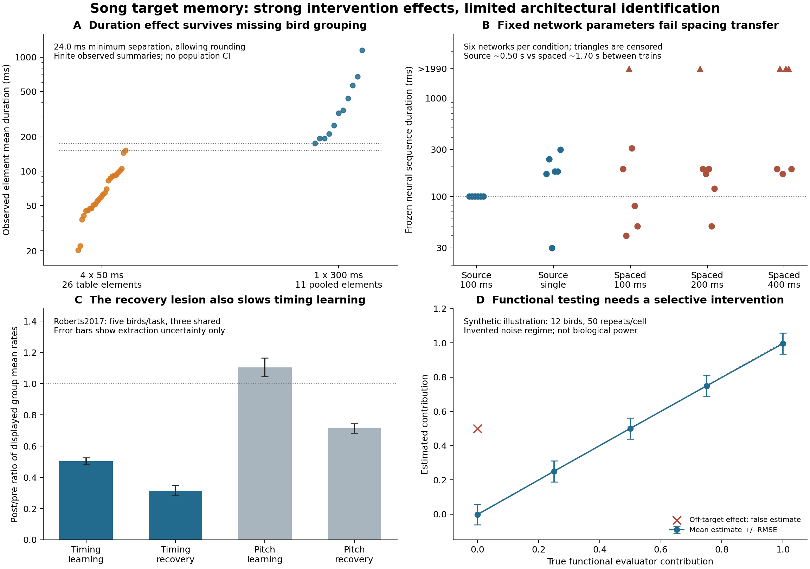

# What songbird interventions identify about a learned target

Focused computational campaign, 2026-10-28. Completed analyses below; final reproduction and adversarial audit recorded separately. This is a bounded follow-through of the earlier campaign, whose artifacts were preserved.

## Result and research decision

**The evidence constrains acquired temporal information and the pathways needed to change song timing more strongly than it identifies a stored comparator.** A purely instantaneous motor imprint and a purely autonomous local restoring mechanism face meaningful controls. A motor timing scaffold whose information is later read through an evaluative/feedback pathway remains compatible with a stored-reference account. A shared trace and synchronized separate traces can also produce the same measured outcomes.

This campaign establishes a source-grounded identification limit, not a new neural mechanism or an empirical victory for one of three broad labels. It combines a checked empirical separation, reconstruction of an adult recovery intervention, execution and stress-testing of a published recurrent-network alternative, exact equivalence results, and a quantitatively validated conditional measurement. The useful next target is **tutor-specific evaluative mediation of practice**, with separately calibrated motor state and perturbation selectivity. Another adult duration endpoint or a passive target decoder would not settle the original architectural distinction.



Panel A shows listed element means, not independent birds. Panel B shows six simulated networks per condition, with censored activity explicitly retained. Panel C gives ratios of source figure means; error bars reflect extraction precision only. Panel D uses invented noise levels to validate an estimator, not to recommend an animal sample size.

## What was actually tested

| Investigation | Substantive test | Outcome / decision |
|---|---|---|
| Zhao artificial tutoring and conflict | Full methods/supplement; independent table transcription; figure digitization; exhaustive condition and bird-assignment bounds | **Retain causal timing effect; reject clean public bird-level model fit.** Rounding-robust observed-summary separation ≥24.0 ms; conflict comparison sign depends on unavailable bird membership |
| Published motor-sequence mechanism | Faithful HVC update port; 40 fixed-protocol network runs; no-learning and parameter controls; changed training spacing | **Retain mechanistic possibility; reduce confidence in quantitative transfer.** Source rhythm gives 100 ms in all six networks; matched wider train spacing gives zero of six at 100 ms without retuning |
| Acquisition gating / adult temporal recovery | Tanaka full methods; Roberts full methods and vector figure summaries; fixed cross-observable gain diagnostic | **Retain pathway constraints; reject selective-comparator interpretation of these lesions.** Temporal reinforcement learning slows alongside recovery |
| Reference / motor / shared identification | Three nonlinear encodings, 1,000 acquisition/practice curricula; scalar potential proof; information-rank analysis | **Retain exact restricted equivalence.** Existing duration-level predictions can coincide; functional sensory/motor readouts still leave one shared-versus-private null direction |
| Discriminating measurement | 60,000 synthetic datasets; known-null and analytic controls; incomplete inhibition and off-target sabotage | **Promote conditional functional mediation test.** Recovers an evaluator contribution when gain and perturbation mapping are known; fails under specified off-target coupling |
| Cooling during tutoring | Located 2024 primary thesis; independently calibrated adult cooling; froze quantitative transfer before juvenile outcomes | **Untested quantitative arm.** MIT throttled acquisition even after its required wait; no juvenile numbers imputed or seminar result treated as a verified dataset |

The focused scope follows the explicit request; a new broad pilot portfolio would have repeated completed work.

## 1. The empirical timing effect survives important metadata problems

Zhao et al.2019 ([primary source](https://pmc.ncbi.nlm.nih.gov/articles/PMC7688245/)) used **four 50 ms pulses, 100 ms apart**, versus **one 300 ms pulse**. Width, onset rhythm, pulse count, and total light exposure (200 versus 300 ms per event) changed together. The study establishes a treatment-regime effect; this comparison cannot isolate a pulse-width code. Mackevicius2020 already recognized and modeled the rhythmic alternative, so that observation is not a novelty claim.

The supplementary table contains 26 short-condition element means, although the main caption reports 25. Their mean is 70.073 ms, matching the printed 70.1; their median is 60.75 ms, versus the main-text 62.3 ms. Every possible single omission leaves the median between 59.2 and 62.3 ms. The 11 long-condition values combine opto-only and natural-plus-opto cohorts and lack condition/bird IDs. Their median is 323.5 ms, which cannot be used as a verified opto-only calibration. These discrepancies are preserved, not repaired by choosing an advantageous deletion or assigning rows by magnitude.

Despite that uncertainty, the largest listed short mean is 152.0 ms and the smallest long mean is 176.1 ms. **Every convex aggregation of retained short means is at least 24.1 ms below every convex aggregation of any nonempty long subset; allowing rounding gives 24.0 ms.** This includes nested within-bird and equal-bird averages, conditional on the observed groups being contained in the supplied table. It says nothing about every rendition, omitted measurements, or a population confidence interval. The original paper reports a by-bird comparison; missing public IDs prevent reproducing it, not demonstrating that it was wrong.

For conflict, we extracted group membership directly from Fig5's plotted marks. Opto-only has seven elements/four birds, plotted median 249.6 ms; natural-plus-opto has four elements/three birds, median 332.2 ms. Conservative extraction envelopes are 236.4–262.8 and 319.0–345.5 ms. They are not biological uncertainty intervals.

We then enumerated all assignments consistent with the stated one-to-three elements per opto-only bird: **315 opto assignments × six conflict assignments**. The accessible marks permit the conflict-minus-opto difference in equal-bird cohort means to range from **−222.1 to +96.9 ms**; conservative extraction error extends this to −248.6…+123.3 ms. Its sign remains unidentified even with a stricter two-element cap. This is a limitation of our accessible summaries, not a claim that the original birds lacked identities or that their analysis was incorrect.

The proposed numeric holdout therefore did not remain clean. Our initially frozen 323 ms calibration was rejected after source reconciliation. Under complete overwrite, all three architectures predict the artificial-only endpoint: the rejected calibration would give a +9.2 ms conflict residual, while the exploratory figure-based recalibration gives +82.6 ms. Neither ranks architectures; neither yields an independent-bird likelihood or an equivalence test. The full provenance and calibration revision remain visible.

Evidence/code: [Zhao methods audit](audits/zhao_source/EVIDENCE.md), [empirical results](outputs/empirical_summary.json), [independent assignment audit](audits/model_audit/EMPIRICAL_AUDIT.md), `experiments/empirical_summary.py`.

## 2. A serious motor alternative works locally and transfers poorly

We acquired and executed the actual recurrent HVC learning equations from [Mackevicius, Happ & Fee2020](https://www.nature.com/articles/s41467-020-18732-x), preserving the original code. The model has 100 binary bursting units, adaptation, feedforward/recurrent inhibition, antisymmetric STDP, heterosynaptic depression, weight constraints and externally driven seed neurons. It is substantially more specific than assigning a convenient scalar motor bias.

The source code maps the short treatment to four one-step seed impulses and the long treatment to one one-step impulse. Actual 50/300 ms pulse width is absent from this mapping. The source's separate continuous-rhythm demonstration also changes network size, adaptation, inhibition and synaptic constraints across periods. We did not use those per-condition adjustments to manufacture transfer.

The Python/C++ implementation uses source parameters and the supplied 7,200-event schedule, but a different declared random-number generator. Independent scalar-loop implementations agree on activity exactly and weights to floating precision (largest independent error 1.11×10⁻¹⁵); a known 50 ms chain verifies the duration readout. Disabling plasticity produces only 10 ms seed responses in both source protocols. No new model parameters were fit to bird outcomes.

With six fixed seeds, the rhythmic treatment produces a clean frozen-weight **100 ms neural sequence in all six**. Single-impulse networks produce **170, 240, 30, 180, 180 and 300 ms**: five of six are longer, but one is shorter. Ten noisy probes per network preserve variability rather than becoming 60 independent subjects. Seed1 rhythm remains 100 ms over the prespecified nonzero-learning-rate and adaptation sensitivity settings.

For a new schedule, all compared conditions received the same 7,200 trains, four impulses per train, and longer spacing between trains (mean 1.70 s versus source 0.50 s). All parameters stayed fixed. At the same 100 ms within-train period, frozen durations became **190, 40, >1,990, 310, 80 and 50 ms**. No network retained exactly 100 ms. The 200/400 ms period conditions also failed to give robust period-length readout; right-censored activity is retained in all summaries. The stress test also increases total simulated time and spontaneous plasticity opportunities; it cannot attribute failure only to onset period. Both schedules are abstractions relative to the biological event spacing.

This changes confidence in a quantitative extrapolation of this particular model. It does not refute motor-scaffold mechanisms. Nor does successful neural sequence generation reproduce voiced element duration: the paper's acoustic segmentation can divide a continuous sound by amplitude modulation, and no common measured neural-to-acoustic readout is supplied. Later primary work ([Mackevicius et al.2023](https://elifesciences.org/articles/77262)) finds sequences before tutoring that can be co-opted into new syllables, further weakening a universal de-novo-chain interpretation while allowing a scaffold.

Evidence: [HVC summary](outputs/hvc/SUMMARY.json), [frozen suite](experiments/HVC_SUITE_PLAN.md), [independent port audit](audits/model_audit/HVC_PORT_AUDIT.md), [prior-work audit](audits/prior_work/PRIOR_AUDIT.md). All 40 jobs succeeded, taking about 905 summed child-process seconds on at most two concurrent local jobs.

## 3. Existing pathway interventions constrain use, but do not selectively erase an evaluator

[Tanaka2018](https://pmc.ncbi.nlm.nih.gov/articles/PMC6219627/) supplies stronger acquisition controls than a permanent early lesion alone: reversible dopamine blockade in HVC during, but not immediately after, tutoring prevents later copying; pairing PAG→HVC activation with playback facilitates copying. HVC physiological changes appear before vocal practice. Gross attentive behavior and tutor song rate controls help exclude simple exposure loss, while PAG inactivation itself affects orienting. These findings constrain an acquisition gate. The same gate can write a reference, a motor scaffold or a shared code. The audited methods do not identify which downstream variable is stored. [Detailed audit](audits/TANAKA_EVIDENCE.md).

Zhao's gradual development after stimulation rejects a strict instantaneous-and-fixed output imprint, while allowing latent motor restructuring whose output develops later. Its pre/post NIf-projector lesions are not a perfectly matched tutoring-order crossover: the pre-exposed group continues tutor exposure after lesion injection until 60 dph. Projection-defined cell ablation also removes any collateral outputs. These limitations matter for interpreting an input bottleneck as a storage location.

A closer test of persistent timing correction is [Roberts2017](https://doi.org/10.1038/nn.4563). In the same adult birds before and after HVC→Av ablation, temporal recovery after reinforcement is impaired (reported paired t(4)=4.8, p=.008). A local restoring mechanism completely independent of that pathway is inconsistent with the reported result under that intervention mapping. But **temporal reinforcement learning also slows in four of five birds**. Pitch learning/recovery is comparatively preserved; this rules against a general inability to alter any feature, not against a timing-specific plasticity, feedback or state-estimation deficit.

That local-mechanism constraint assumes lesion-specific causation and an otherwise unchanged local state. Every bird was tested intact first, no Fig6 sham/retest cohort is supplied, at least three weeks elapsed, projection-cell ablation is partial, and baseline timing changes slightly; these leave chronology and permissive network effects unresolved.

We extracted caption-defined mean markers from the vector figure, not paired observations from boxplots. Temporal learning rate changes from **2.042 to 1.028 ms/day** and return rate from **1.236 to 0.389 ms/day**: ratios of group means 0.503 and 0.315. Each mean's extraction envelope is about ±0.031 ms/day. The metric is syllable onset to the next onset (syllable plus gap), not voiced duration or gap alone. Actual slope fitting/sign handling is not fully specified, and observation windows differ pre/post.

A one-gain diagnostic calibrated only to the learning-rate ratio predicts return 0.622 ms/day, versus the displayed 0.389. That captures part of the rate reduction but is not a valid bird-level model comparison: raw pairs, slope definitions and sampling uncertainty are absent. We explicitly did not substitute these rates for the recovery fractions required by the frozen exponential model. Neither complete selective evaluator erasure nor pure preserved local timing dynamics is established. A motor-stored target read through a feedback route remains viable.

Evidence: [Roberts source/control audit](audits/roberts/EVIDENCE.md), [rate calculation](outputs/recovery_summary.json), [original conditional protocol and correction](experiments/RECOVERY_PROTOCOL.md).

## 4. The architecture ambiguity is explicit, and the proposed discriminant has failure controls

Let an acquired temporal code be `z_next=(1−a)z+a φ(c_T d)`, where a is a write gate, φ a monotone encoding and c_T a tutoring clock speed. A stored reference can drive gradient correction toward z; a motor scaffold can create the same attracting dynamics without calculating a score; a shared code can feed both readouts. Acquisition-pathway removal can prevent writing in all three while a post-acquisition removal leaves downstream state intact. The state/lesion mapping must be justified independently—it is not supplied by the architecture's name.

Independent implementations with linear, log and square-root coordinates give entire practice trajectories identical within 1.91×10⁻¹⁴ across 1,000 varied curricula, not merely fitted endpoints. More generally, a smooth scalar drift f(x,z) can be generated by the gradient of `R(x,z)=∫f(u,z)du`. That mathematical representation does not show the brain calculates R. The result is restricted to scalar effective timing models and does not claim all multidimensional or history-dependent mechanisms equivalent.

Similarly, an internal-clock reference and a shared/motor code all predict `D_pupil/D_tutor=c_T/c_P`. Cooling direction therefore distinguishes an unaffected external-time encoder from an internal-clock encoder under exclusions; it does not classify reference versus motor storage. The cooling-memory lead was traced to Bahle's 2024 MIT thesis. We froze an adult-based prediction (at 5°C cooling, ratio 0.876) before juvenile numbers, but the thesis download remained throttled. Adult execution gain is not automatically juvenile acquisition gain. **No quantitative cooling validation is claimed.**

For a local decomposition into private reference r, private motor trace m and common trace s, functional readouts are S=r+s and M=m+s. A duration endpoint `Y=wS+(1−w)M` identifies one combination. Adding calibrated evaluative-target and motor readouts identifies two, but `(r,m,s)→(r−h,m−h,s+h)` leaves both unchanged. A third linearly independent, validated probe is required in this model; a selective common-trace intervention is one example. A nonlinear duplicate-trace construction gives the same practical warning: correlated readouts do not establish one physical memory.

The more useful test asks whether tutor-specific evaluation **causes** practice updates. Cross small positive/negative auditory feedback shifts with selective evaluator-pathway inhibition within each bird, match immediate output/exposure/exploration, measure subsequent after-effects, and independently calibrate update gain. Pair this with tutor-specific evaluative tuning at matched heard sounds and motor states. The interaction estimates a functional evaluator contribution; unknown gain or inhibition efficacy remains multiplied into that quantity.

The prespecified 60,000 synthetic datasets include true nulls, noise/sample-size grids and analytic checks. In one illustrative regime (12 simulated birds, 50 repeats/cell), a 0.25 contribution is detected 96.5% of the time, RMSE 0.061; the null positive rate is 2.1%. These are not biological power estimates. Deliberate off-target auditory coupling yields a false estimate of 0.5 even when the intended evaluator contributes zero; incomplete inhibition scales the estimate. Motor-stored timing read out into the same evaluator still produces exactly the same successful test. Thus the validated test narrows functional mechanism without claiming anatomical storage identification.

Detailed equations, code, exclusions and failure cases: [independent model audit](audits/model_audit/MODEL_AUDIT.md), [results](audits/model_audit/audit_results.json).

## What changed and what deserves attention

The starting question treated three verbal accounts as potential competitors. Formalization and primary methods show substantial overlap. We added a real sequence-network competitor, found limits to its fixed-parameter transfer, preserved a robust empirical timing effect despite metadata inconsistencies, and found that a promising recovery lesion is not selective for recovery. The cooling lead is older primary work, but its quantitative claim remains unverified here.

**My recommended research action is to test tutor-specific evaluative mediation, with temporal plasticity and motor-state controls built into the same intervention.** The key assumption to audit is perturbation selectivity: does the manipulation remove evaluation while preserving the temporal state estimate, exploration and capacity to update? The present HVC→Av lesion does not establish that exclusion. I would change this recommendation if a primary dataset supplies validated selective access to the stored trace or directly links a tutor-specific evaluated error to subsequent updates under matched motor state. More pooled adult-duration observations would not meet that standard.

No new biological discovery, untouched empirical predictive win, raw longitudinal replication, causal identity of a tutor memory and an adult setpoint, or unique storage-site localization is claimed. The source discrepancies do not establish that published statistical analyses were wrong. The identification claim is deliberately narrower than universal impossibility.

## Reproduction and boundaries

From repository root:

```sh
.venv/bin/python campaigns/song_target_memory_2026-10-28/experiments/reproduce.py
.venv/bin/python campaigns/song_target_memory_2026-10-28/experiments/reproduce.py --full
```

The first command verifies pinned evidence and executed network results, reruns source-summary calculations, independent checks and synthetic recovery, then rebuilds the figure. `--full` also rebuilds/reexecutes the 40 network runs (roughly 15 summed process minutes; at most two concurrent jobs). Both modes use the environment recorded in `ENVIRONMENT.json`: Python dependencies are in `requirements-lock.txt`; PDF extraction additionally uses pdfplumber 0.11.9 in the recorded bundled runtime (override with `PDF_PYTHON`). The neural kernel build is configured for macOS/clang++; other platforms require a build adaptation. `INPUTS.json`, `CACHED_MODELS.json`, `REPRODUCTION.json` and `COMPLETION_AUDIT.md` record hashes, execution status and claim limits. See `SOURCES.md` for primary-source and acquisition pointers. Public inputs are preserved; figure coordinates are derived measurements rather than invented raw observations.

Source acquisition used ordinary public pages, one normal browser download, and supported HTTP206 archive-member reads with CRC/hash checks. No paid APIs, rented compute, accounts, external messages, author contact, private uploads, publication, permission changes or access-control bypass were used. Cooling is a documented blocked arm, not a fabricated quantitative success. The campaign stops here after the executed follow-through and adversarial audit; remaining scientific uncertainty is explicit.
