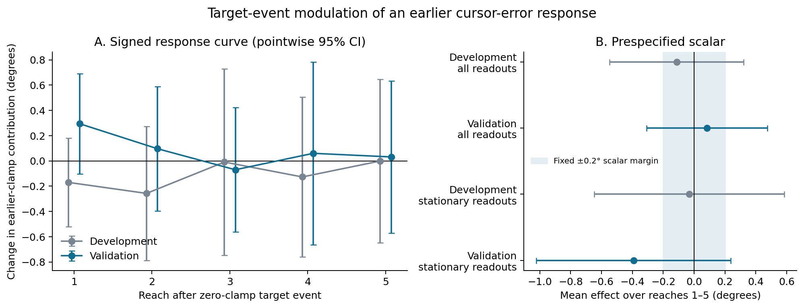
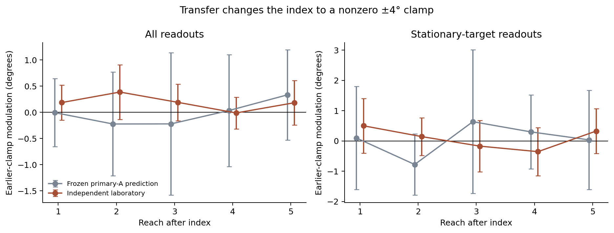
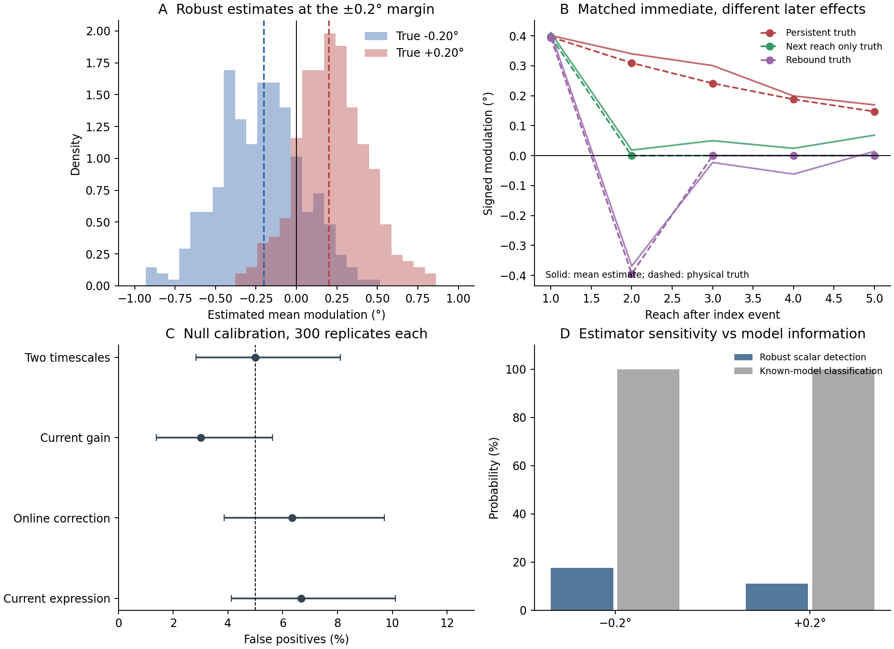

# Target events and the continuing influence of earlier cursor errors

**Completed empirical investigation — 2026-10-28.** Primary validation and independent-laboratory outcomes are consumed. Figure4 and the optional210-person geometry dataset remain unexamined. Offline replay and final adversarial review are recorded separately below.

## What the investigation establishes

**No reproducible target-event propagation law was established, and the prespecified ±0.2° absence bound was not earned.** In20 reserved primary participants, the signed change in the earlier-clamp contribution averaged **+0.083° over the following five reaches, 95%CI[−0.309°, +0.474°]**. The ordinary earlier-clamp response was clearly present: **+0.677°[0.360°,0.995°]**. The modulation estimate is12% of that response, with an approximate clustered Fieller interval from−48% to+102%. Thus a0.2° change—about30% of the ordinary response—remains consequential and unresolved.

Adding earlier-input propagation terms to the frozen distributed-lag predictor **worsened** reserved-person prediction. Two more efficient dynamical fits yielded small development effects, but their apparently narrow intervals failed known-effect calibration. A targeted covariance-aware repair reduced one failure mechanism without producing a general valid bound. The independent laboratory did not establish transport: its different, nonzero-clamp contrast was+0.186°[−0.069°,0.440°].

The defensible result is a **quantified discrimination limit for the tested analyses on these data**, together with a demonstrated inference trap and an exact mechanistic ambiguity. It is not a claim that the sequences contain no information: known-generator oracles discriminate stipulated alternatives extremely well. Nor is it a claim that target events have no effect. The completed tests do not support either a transferable signed law or a meaningful general absence claim.

## Frozen question, estimand and exposure

Let t be an index trial with zero programmed cursor clamp. Compare a target jump on t with a stationary target. The precursor is a±4° clamp on t−1 with its target stationary. For each h=1,…,5, take half the difference between the jump-versus-stationary effects following+4° and−4° precursors. Average these five signed half-contrasts equally, then give the two primary sets equal weight. Positive values mean increased compensation to the earlier positive clamp. This is a half-contrast relative to the±4 midpoint; it is not necessarily a+4-versus-zero contrast under a nonlinear response.

The margin **±0.2°** was fixed before raw carryover effects were inspected. It is5% of the programmed4° precursor, chosen as a practically material angular change rather than a clinical or perceptual threshold. The full curve accompanies the mean because a rebound can cancel in the scalar. This population-average signed estimand also does not bound opposing effects across people or sets. No favorable lag, direction or larger equivalence margin was selected after validation.

Twenty of40 primary participants were allocated to development and20 to validation, ten per source set, by a hash of file name and participant ID. Published aggregate findings and input schedules were already known; raw carryover outcomes were not. [Split](protocol/split.json), [initial decisions](protocol/INITIAL_DECISIONS.md), [amendments](protocol/AMENDMENTS.md), and [analysis specification](protocol/ANALYSIS_PROTOCOL.md) document exposure and choices. These are local predeclared/frozen records, not a public registration.

The final freeze at22:37:37UTC hashes46 code, protocol and predictor artifacts. The reserved primary outcomes were released at22:37:38UTC; external Figure3 at22:38:44UTC. Every loader verified those hashes before outcome access. No substantive analysis choice changed after these releases. [Freeze](protocol/FINAL_FREEZE.json), [primary release](protocol/VALIDATION_RELEASE.json), [external release](protocol/TRANSFER_RELEASE.json).

## Main empirical results

All intervals below are95% participant-cluster intervals. The primary test is the reserved-participant change-score row. Other rows are declared sensitivities or descriptive aggregation.

| Analysis | People | Mean modulation, degrees | 95%CI |
|---|---:|---:|---:|
| Development, primary specification |20|−0.113|[−0.547,+0.322]|
| **Reserved, primary specification** |**20**|**+0.083**|**[−0.309,+0.474]**|
| Reserved, endpoint levels |20|+0.023|[−0.290,+0.336]|
| Reserved, later stationary-target readouts |20|−0.392|[−1.023,+0.238]|
| Reserved, source `Hand` missingness mask |20|+0.198|[−0.111,+0.508]|
| Reserved, source-transformed `Hand_dt` |20|+0.152|[−0.102,+0.407]|
| All40, descriptive equal-stratum aggregate |40|−0.015|[−0.296,+0.266]|

The combined row includes development data that informed the method and is not another untouched confirmation. The unknown `Hand_dt` preprocessing prevents its narrower interval from being privileged over the original endpoint. The stationary-readout result is substantially noisier and has sizeable negative late point estimates; it should not be described as uniformly near zero.

| Reach after index | Development primary | Reserved primary | Reserved stationary-readout sensitivity |
|---:|---:|---:|---:|
|1|−0.170|+0.295|+0.005|
|2|−0.257|+0.097|+0.428|
|3|−0.009|−0.070|−0.939|
|4|−0.127|+0.060|−0.533|
|5|−0.001|+0.032|−0.921|

These are signed degree-scale half-contrasts, not fitted retention parameters. Pointwise intervals and the full covariance matrices are in [lag table](outputs/lag_curves.csv) and the underlying JSON outputs. Individual lag excursions are not five separate confirmatory discoveries. Later stationary targets remove one contemporaneous target-motion artifact, but they do not prove that intervening input effects or lingering expression have disappeared.



Reserved setA estimated+0.318°[−0.196,+0.833]; setB−0.153°[−0.816,+0.510]. Their uncertainty is large. Leaving out each person in turn gives pooled point estimates+0.009° to+0.190°; no deletion is used to choose the reported result. The pre-index endpoint placebo is−0.060°[−0.456,+0.337], an association diagnostic rather than a causal effect on the past. The broader marginal signed-input secondary contrast, which was nominally negative in development, did not confirm on validation:−0.055°[−0.399,+0.290].

The earlier-clamp signal itself replicated: development+0.723°[0.444,1.003] and reserved+0.677°[0.360,0.995], from endpoint levels with a stationary index target. This establishes that the assay contains an earlier-input response to test; it does not rescue the precision of the modulation contrast. Independent development extraction controls also recover larger next-trial compensation without target motion (raw endpoint differences:1.879°/2.065° in A/B) than with spatial jumps (1.367°/1.586°). Those current-input summaries are background controls, not the earlier-input result; the source-transformed endpoint changes their amplitude. [Extraction controls](outputs/source_controls_summary.json). [Ordinary-response figure](outputs/figures/ordinary_response.png), [relative-effect interval](outputs/validation_relative_effect.json).

## Conditional prediction on reserved people

Development-fitted coefficients predicted future-minus-pre-index-average responses on entirely reserved participants, conditional on their assigned input sequences. No reserved gains, retentions or noise parameters were fitted. The restricted distributed-lag model permits flexible current and historical input-cell responses, current/intervening/readout effects and drift, but excludes index-event×older-input terms. The full model adds those terms. Both state-model pairs share the same flexible current-cell gains, direct endpoint terms, participant variation and drift structure within each pair.

Positive MSE gain below favors the propagation model. Units are degrees squared; uncertainty uses people within source sets and Welch pooling.

| Frozen comparison | Reserved MSE gain |95%CI|
|---|---:|---:|
| Distributed lag, all readouts |−0.0912|[−0.1453,−0.0370]|
| Distributed lag, stationary readouts |−0.2647|[−0.3959,−0.1335]|
| Two-state OLS profile model |−0.0020|[−0.0102,+0.0063]|
| Two-state covariance-aware FGLS model |−0.0012|[−0.0109,+0.0086]|

The all-readout restricted distributed-lag MSE was10.444, compared with10.535 for the full model and13.092 for a zero-change forecast. The added flexibility did not generalize. This is evidence about these frozen predictors, not proof that all propagation effects are absent. In particular, failure of an overparameterized predictor cannot substitute for an observable equivalence interval. [Person-level prediction results](outputs/validation_prediction_all.json), [OLS state forecasts](outputs/state_models_validation.json), [FGLS forecasts](outputs/state_models_fgls_validation.json).

## Independent laboratory: executed transfer, not exact replication

Al-Fawakhiri et al.2023 Figure3 supplied18 untouched participants. Its index clamps are always±4°; there are no randomized zero-clamp main trials. We froze the development setA earlier-clamp curve as an unchanged degree-scale prediction for JumpTo versus NoJump under those nonzero current clamps. This explicitly hypothesizes invariance across current clamp and laboratory conditions. Current-error, intervening-input and readout terms are accounted for separately. External nuisance fits estimate the conditional contrast; they do not refit the predicted propagation curve or create a whole-trajectory forecast.

| Transfer contrast | Frozen primary-A prediction | External estimate | External95%CI |
|---|---:|---:|---:|
| All readouts |−0.017°|+0.186°|[−0.069,+0.440]|
| Stationary readouts |+0.057°|+0.089°|[−0.293,+0.471]|

The all-readout external-minus-prediction difference is+0.203°[−0.579,+0.985], incorporating uncertainty from both laboratories. This is wide compatibility, **not successful predictive transport**. Neither external interval supplies the original±0.2° bound. The source-A prediction was itself uncertain; its inclusion in an external interval is not strong evidence for a law.



Flicker, coded `0.01`, remains a distinct historical input rather than a small spatial jump. Figure4, with different magnitudes/target sizes and a reversed raw jump-sign convention, was not consumed. [Frozen transfer prediction](protocol/TRANSFER_PREDICTION.json), [external results](outputs/transfer_fig3.json), [independent transfer-method review](audits/transfer_check/TRANSFER_REVIEW.md).

## What recovery establishes—and why narrow model bounds failed

The robust primary analysis was tested on actual reserved input schedules with synthetic outcomes. Controls included current-gain-only learning, fixed fast/slow retention, both modulation signs, direct online correction, current and delayed expression, rebound, correlated motor/observation noise, drift, participant heterogeneity and omissions. Physical counterfactual effects were distinguished from noiseless regression projections; explicit four-way chronological interventions verified the physical calculation.

At actual-schedule effects around−0.2°/+0.2°, the change-score estimator detected the correct sign in17.7%/11.0% of300 simulations per sign. Coverage was94.3%/96.7%. Correctly specified linear controls were similarly weak. Null false positives were3.0–6.7%. A further600 paired long-memory/strong-drift null runs gave5.67% false positives. Endpoint-level recovery reduced SE by about28%, but detection remained16%/13%. No interval in these primary recovery sets established±0.2° equivalence. These rates describe the stipulated noise/generator regimes, including a conservative omission mask; they are not universal power claims.

External recovery used900 simulations on actual Figure3 schedules. All-readout coverage was about96%, with31–38% detection at±0.2°; stationary-readout detection was13–17%. This supported executing the planned transfer contrast but not interpreting nonsignificance as no effect. [Primary recovery report](audits/recovery_design/RECOVERY_REPORT.md), [long-memory null](outputs/recovery_slow_null_report.md), [level recovery](outputs/recovery_level_report.md), [transfer recovery](outputs/transfer_recovery/recovery.json).



Known-generator Gaussian oracles distinguish the tested±0.2° propagation laws from fixed retention with greater than99.99% accuracy, even after projection of specified nuisance directions. They know the generating parameters/covariance and use much more of the trajectory than the sparse primary contrast. This motivated a serious efficiency attempt rather than declaring the data intrinsically uninformative.

The single matched two-state model shared transition rates across people and both sets while allowing person-specific input-cell gains, current endpoint effects, drift and initial states. Its event parameter altered the fast state only. Development OLS estimatedθ=+0.0245°, with a200-refit participant bootstrap interval[−0.0374,+0.0913]. That attractive interval **cannot support the general scientific absence claim**:

- In100 correctly specified fast-state positive-boundary simulations,14 intervals falsely lay wholly inside±0.2°.
- A slow-state−0.2° challenge produced10/50 false-equivalence intervals; those fits also flagged boundary problems.
- A rebound with true five-reach mean zero produced36/50 falsely nonzero model intervals.
- Exact empirical multistart optimization checks changed estimates by at most2.56×10⁻⁶°, excluding the simplified simulation optimizer as the explanation in the checked cases.

An independent exact calculation identifies a concrete bias source. After individual gains are fitted, the expected residual noise loss is `tr[(I−P_parameter)Sigma]`. With colored noise, that term changes with the retention parameters even when model rank is fixed. In a+0.2° control, wrong dynamics impliedθ≈0.164° and worsened genuine signal fit by53.8 squared-degree units, but captured173.6 additional noise units. Expected total loss therefore preferred the wrong dynamics. The same wrong dynamics worsened the iid-noise objective. A narrow bootstrap can reproduce this criterion's stability without repairing its bias. [Exact calculation](audits/adversarial_review/profile_noise_bias.json).

We executed one targeted correction within the same mean-model family. Known-covariance GLS reduced failures in deliberately selected difficult simulations; those selected cases are not a population coverage estimate. Practical FGLS estimated a common AR1 covariance from development restricted-model main residuals, then held it fixed across the two models. Baseline covariance was unsuitable as an automatic substitute because the feedback regime and serial dependence differed. FGLS estimatedθ=+0.0332°, local conditional95%CI[−0.0150,+0.0813]. Repeating the complete calibration procedure gave91%,92%,93% coverage for null,+0.2°,−0.2° and8/100,4/100 false-equivalence intervals at the signed boundaries. Broad expression-kernel robustness was not established. Its narrow conditional interval therefore also does not earn a general bound. Both original and repaired forecasts were retained and tested on reserved people. [Complete efficiency/repair report](audits/state_models/REPORT.md), [adversarial stress review](audits/adversarial_review/SECONDARY_STRESS_REVIEW.md).

## Measurement and mechanistic limits

The primary measurement is `−Hand_raw`, an **exported unmasked endpoint**, not verified acquisition-raw or initial-heading data. Independent development algebra found that `Hand` masks the same values, while `Hand_Diff` differentiates an unspecified `Hand_dt` transform and crosses participant boundaries at seven directly checked terminal rows. We rebuilt chronology and never used those contaminated transitions. The pinned repository lacks acquisition, export-preprocessing and exact randomization code. Observed schedules balance nine actual cells over180 trials; the paper's24-trial description is not used to invent an exact permutation test.

SetA's old clamp and old target jump are not Cartesian, which is why the primary contrast fixes the preceding target stationary. Participant IDs restart across files and are always keyed jointly with file. The boundary-safe design retained4,136 development and4,114 reserved index events; the essential precursor±4/stationary cells support only about900 events per partition. Three potential reserved index events were excluded by the fixed endpoint rule. The full future stationary path is too sparse to support five undisturbed probes: later stationary **readouts** still marginalize over intervening assigned inputs. [Measurement audit](audits/source_measurement/AUDIT.md), [support table](outputs/input_support_person.csv).

Even a robust positive observable result would not uniquely identify storage. In a scalar witness,

`x_next = a_J*x + b*c`

is identical to fixed intrinsic retention plus a fresh state-dependent perceived error,

`e = c − ((a_star−a_J)/b)*x;  x_next = a_star*x + b*e`.

Zero programmed clamp does not imply zero internal error. Both modulation signs can use nonnegative correction weights. Independent implementations match the paired paths on all40 schedules to floating precision; matched observation likelihoods give oracle accuracy50%. A suitable dynamic expression process supplies another exact equivalence. This is an exact limit for those paired accounts, not a statement that every constrained multistate model is equivalent. Target motion also changes visual information and task error; it does not uniquely manipulate reward. [Independent design proof](audits/design_challenge/DESIGN_CHALLENGE.md).

## Scientific decision and next action

This investigation changes the judgment from “excited input schedules should permit a decisive retention test” to a narrower conclusion: **the available earlier-error signal is real, but neither a robust0.2° modulation/absence result nor a transferable propagation law survives the completed checks.** Flexible direct estimates are imprecise; narrow dynamical bounds depend on assumptions that fail meaningful known-effect challenges. This is a demonstrated analysis-resolution and model-assumption problem, not proof that no better estimator could exploit these sequences.

The campaign is complete because the reserved test, independent transport, recovery, oracle discrimination, covariance-aware repair, original-byte reconstruction and adversarial challenge have all been executed. The remaining uncertainty is not an unrun pipeline or an inaccessible validation set. Further fitting of these same consumed endpoints would be exploratory and would require additional assumptions; it cannot break the exact storage/perceived-error equivalence on its own.

**Recommended next scientific action:** stop using these exports to seek a general0.2° storage claim. Prioritize a targeted precursor/event/probe experiment: keep the precursor target stationary, randomize its signed error and the subsequent zero-clamp target event, hold the next five readout conditions common, record initial heading as well as endpoint, and obtain an independent perceived-hand/goal measurement to constrain fresh internal-error correction. Evaluate that assay by recovery before collecting a larger dataset. Merely adding more endpoints of the same observational form or quoting a tighter retention fit would not resolve the demonstrated mechanistic ambiguity. No successor experiment, contact, paid job or recurring automation was launched.

## Reproduction and audit trail

From repository root, using the recorded Python3.9 environment:

```sh
.venv/bin/python campaigns/target_event_carryover_2026-10-28/experiments/reproduce.py
```

This runs entirely offline, verifies all five source hashes and all46 frozen artifacts, reconstructs development/reserved contrasts, independently reconstructs the decisive reserved statistic from original bytes, evaluates frozen predictions and transfer, and regenerates figures/tables. It checks that decisive estimates match saved results. `--full` additionally repeats the major simulation controls; individual report files document commands for the remaining diagnostic/level/GLS checks. Dependencies are pinned in [requirements.txt](requirements.txt); environment and original Git/SHA256 provenance are in [provenance](provenance/environment.json) and [source manifest](provenance/source_manifest.json).

Independent reserved reconstruction agrees with the lead to below10⁻¹⁴, including cell-event coefficients, lag contrasts and uncertainty. [Validation audit](audits/independent_extraction/VALIDATION_AUDIT.md). Final replay status: [offline check](outputs/offline_reproduction_check.json). Final scientific review: [adversarial review](audits/adversarial_review/FINAL_REVIEW.md). All failures, preliminary controls, code and exposure records are preserved. [Sources actually inspected](SOURCES.md), [numeric scalar table](outputs/scalar_estimates.csv), [current state](STATE.md).

The closest prior work already includes learning/retention comparisons ([Kim et al.2019](https://elifesciences.org/articles/39882)), target-motion/task-error models ([Tsay et al.2022](https://doi.org/10.1371/journal.pcbi.1010005)), target-size/target-jump comparisons ([Al-Fawakhiri et al.2023](https://doi.org/10.1152/jn.00061.2023)), and perceived-error learning ([PReMo](https://pmc.ncbi.nlm.nih.gov/articles/PMC9377801/)). The contribution here is the frozen earlier-input test and the measured limits of its interpretation, not a claim to have invented gain-versus-retention or exhaustively established novelty.
