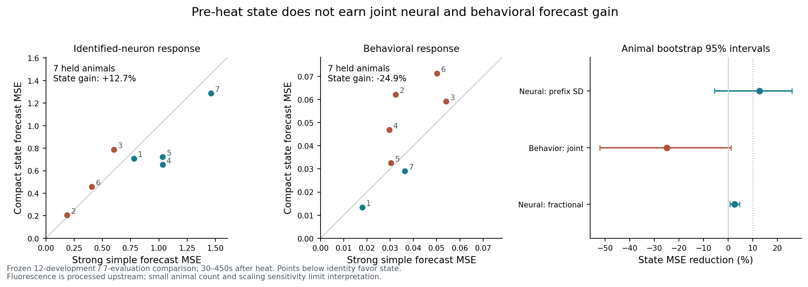

# Persistent heat-response forecasts: bounded result

The frozen compact-state forecast **does not earn the joint neural-and-behavioral success criterion**. It gives a modest, scale-sensitive neural improvement and loses to a stronger simple behavioral forecast. This supports banking a restricted prediction result and requesting an independent contrary review; it does not justify a larger mechanistic state-model campaign or establish absence of useful neural state information.

## Main held-animal result

An outcome-blind hash split assigned 12 development and 7 evaluation heat worms. Choices were frozen at 2026-10-31T17:57:34Z. All evaluation forecasts were saved at17:58:01.847Z before numerical outcome decoding began. The endpoint is seven60-second means,30–450seconds after heat. Identified-neuron errors average across available classes within each animal; behavior combines negative-velocity frame fraction and pumping with fixed development-prefix scales. Animals receive equal weight.

| Endpoint | Strong simple MSE | Compact state MSE | State MSE reduction, animal-bootstrap95%interval | State better |
|---|---:|---:|---:|---:|
| Neural, prefix-SD units |0.787565|0.687250|+12.74% [−5.52%,+25.85%]|4/7|
| Behavioral, standardized joint score |0.035901|0.044852|−24.93% [−52.18%,+1.11%]|2/7|
| Neural, fractional-fluorescence sensitivity |0.033758|0.032912|+2.51% [+0.62%,+4.63%]|5/7|

The declared rule required at least10% reduction and a positive paired95%lower improvement in **both** primary modalities. It fails. The seven-animal intervals describe finite sampling uncertainty conditional on these recipes; failure is not an equivalence bound. Removing2023-01-05-01, specifically named in the previously read mechanistic paper, leaves neural gain8.68% and behavioral gain−27.42%; neither passes. All19animals' publication/mirror summaries had already been exposed, so this is a summary-informed retrospective archive test with previously uninterpreted evaluation numbers.

[Actual primary output](EVALUATION_RESULT.json), [frozen choices](EVALUATION_FREEZE.json), [forecast-save record](FORECAST_SAVED.json), [outcome-access timestamps](EVALUATION_OUTCOME_ACCESS.json).

## What the stronger alternative changed

The original development comparison gave only2.23% neural gain and−0.40% behavioral gain over source-learned own-history forecasts. Separating behavioral channels exposed a stronger alternative. The one explicit development revision selected own-prefix mean/recent-state relaxation with a120second time constant plus a shared heat response for reversing, and literal zero pumping after heat. Neural comparison and compact-state family stayed unchanged.

On held animals this simple combination improves joint behavioral error29.16% [8.59%,44.27%] over the shared absolute heat curve. Reversal error improves26.67% [0.39%,43.43%] versus that curve, but only9.86% [−13.65%,30.89%] over own-prefix persistence. Zero pumping improves56.45% over the shared pumping curve and99.52% over pre-heat pumping persistence. Thus a substantial gain over the average heat response does not by itself establish a new individual neural-state mechanism; the shared feeding floor and ordinary behavioral history matter.

Timing controls also matter: delaying the state response by120seconds raises neural MSE0.687→1.018 and behavioral MSE0.0449→0.1627. Stimulus-free local relaxation is worse still overall. These are frozen forecast ablations, not randomized no-heat causal controls. [Verification and component errors](VERIFICATION.json), [original development](DEVELOPMENT_RESULT.json), [preserved revision](DEVELOPMENT_REVISION.json).

## Neural information remains a limited positive, not a clean null

The strongest primary neural comparator uses source-learned own-channel prefix mean, recent activity, drift,30second autocorrelation and observation coefficient of variation. The compact augmentation adds pre-heat reversing and pumping rates plus two source-fixed neural PCs. Models are regularized regressions of persistent bin means, not mechanistic differential equations. Separate source-only penalties are selected by leave-one-worm-out CV; development scores include that selection and are optimistic.

The fractional-fluorescence sensitivity reduces the neural gain to2.51%, so the apparent magnitude depends strongly on the error scale. A postvalidation restriction to the16neuron classes observed in every evaluation worm retains13.57% [6.26%,21.14%] gain; missing class composition alone does not erase it. This diagnostic does not replace the primary29class eligibility rule. Coverage is19–29classes per held worm, with identical masks for paired models.

Postvalidation feature knockouts preserve the source alpha1 and do not tune on evaluation. Full-state MSE is0.68725, behavior-only augmentation0.73043, neural-PC-only0.78661. An essential matched-alpha own-history control gives0.83738; the frozen, source-selected own-history alpha10 is stronger at0.78757. These comparisons show contributions can depend on both behavioral context and regularization. They do not identify a unique neural mechanism or certify a new winning recipe. Initial and matched attribution records are both retained. [Plan](POSTVALIDATION_PLAN.md), [matched output](POSTVALIDATION_ATTRIBUTION_MATCHED.json).

## Reliability and limits

All31saved forecast arrays replay exactly. A separate scalar MSE formulation matches the main output within4.45e−16. Direct-solve versus SVD ridge differs by2.23e−15. Replacing every development future observation leaves all feature bundles unchanged; the lexical prefix reader passes the corresponding synthetic poison test. On actual evaluation files, prefix-only and later full-data feature arrays agree exactly. Frozen hashes and forecast hash remain valid. These are author checks, **not independent scientific review**.

Known-answer controls use12source/7held synthetic animals, with within-animal noise shared across bins/classes. The augmented estimator improves94/100strong-signal draws, while the complete10%-plus-positive-interval rule succeeds57/100; null draws pass5/100. This establishes capability in a declared generator and illustrates weak small-sample decision sensitivity. It is not actual-data power or a biological equivalence calibration. [Controls](KNOWN_ANSWER_CONTROLS.json), [replay](REPRODUCTION.json), [prefix control](PREFIX_READER_CONTROL.json).

Source preprocessing interpolates missing ROIs and fits bleaching over whole recordings; prefix normalization cannot undo that. Neuron identities are post-hoc annotations. The study predicts coarse response distributions, not precise stochastic trajectories, uses one pulse per worm, and contains no new unstimulated cohort. Fixed-state versus changing-parameter accounts are unrestrictedly non-identifiable. A successful restricted forecast would not establish synaptic change; this failed joint comparison does not rule out other informative state descriptions.

## Prior work and allocation

[Atanas/Kim et al.2023](https://pmc.ncbi.nlm.nih.gov/articles/PMC10836760/) already establishes state-dependent behavioral encoding. Its methods describe single-pulse heating, rapid thermal dissipation and whole-record processing. The checked export has explicit event indices and roughly eight minutes of finite pre/post neural and behavioral recording. [Morrison/Young2025](https://journals.plos.org/ploscompbiol/article?id=10.1371/journal.pcbi.1013818) already reproduces premotor switching with recorded signal inputs; its heat-like perturbation lacks persistent post-perturbation state. We did not reproduce that mechanistic model or establish exhaustive novelty. Exact provenance/license qualifications are in [SOURCES.md](SOURCES.md) and the source manifest.

Recommendation: bank the simple behavioral forecast and the qualified neural predictive signal. Do not promote a joint predictive mechanism or launch a larger architecture search from these numbers. The single highest-value independent contrary test is a fresh reconstruction of the frozen held-animal contrast from pinned bytes, concentrating on prefix masking, label aggregation and normalization/behavior-only explanations of the neural gain. Reuse consumed assets; this worker commissions no successor.

All19heat worms are now consumed; none can be called a fresh holdout again. The four reserved baseline worms and every older protected target remain unopened. Conservative reservations are28/32requests,191,385,005/200,000,000acquisition bytes and413,641,303/500,000,000scientific-input bytes, including failed DNS reservations and cache rereads. Numerical work is serial with BLAS/OMP cap1; full-process peak RAM was not OS-profiled. The bounded work finished well before its120minute deadline, with no background jobs. [Accounting](ACCOUNTING.json), [state](STATE.md), [reproduction commands](README.md).

