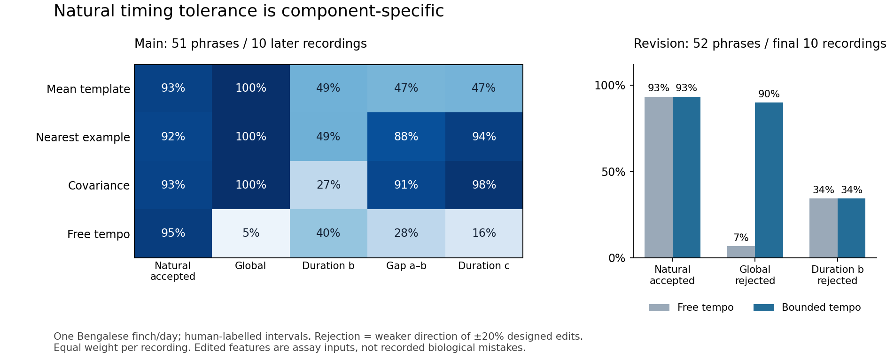

# Repeated natural timing examples support selective correction, with a clear limit

Repeated examples supplied useful timing tolerance in this finite assay, using ordinary nearest-example and covariance scores. They did not yield uniform correction across all declared timing edits. Every method failed the frozen full criterion. A simple tempo bound repaired free alignment's global-scale blindness, without fixing its local-duration failures. This result supports a small statistical measurement benchmark; it does not establish a new evaluator architecture, biological error signal, or an information limit.

## Actual evidence and allocation

The first complete primary-source archive fitting the acquisition budget was Nicholson/Queen/Sober's `gy6or6/032612`:39 WAV recordings,39 corresponding CSV annotations,410.07253125 s. The full archive MD5 matches the primary metadata. An earlier capped prefix of the first lexical bird/day exposed leading audio but no annotations; that failure and all bytes are preserved. Selection depended on availability/input support, not evaluator performance.

This is **one identified adult Bengalese finch/day**, recorded as undirected baseline song. The recordings are examples for a computational task; the source supplies neither tutor–pupil relationships nor natural error/perceptual judgments. Its human labels use acoustic structure and sequence context. All metrics receive those labels/segment boundaries. Thus this is a five-interval symbolic timing assay, not recognition from acoustics. Earlier bl26lb16 audio was inspected only for acquisition feasibility and is not a second inferential bird.

The first6 chronological recordings provided27 repeated `abc` phrases. This was the most common consecutive nonintroductory trigram with3 distinct labels, with count ties resolved lexically. Five intervals are duration_a, gap_ab, duration_b, gap_bc, duration_c; initial coefficients of variation were7.05%,5.73%,12.65%,7.42%,3.27%. The main protocol/code/allocation were hash-frozen at01:33:27.669668Z on2026-11-01 (Oct31 local), before later scores. First19 recordings supplied98 teaching examples; next10 supplied51 main examples; final10 supplied52 initially reserved examples. Fit/calibration/evaluation give equal total weight to each recording. All201 phrases and2693 source annotations are now consumed development evidence.

## Main result, with all primary failures retained

Teaching-only leave-one-recording-out95th-percentile thresholds were fixed before later evaluation. These are finite empirical thresholds, not coverage guarantees. The full criterion required at least90% natural acceptance plus80% rejection and80% strict paired cost increase for **each** of eight20% challenges (global timing, duration_b, gap_ab, duration_c; each shortened/lengthened). Factors0.9/0.95/1.05/1.1 are also saved and do not redefine the gate.

| Method | Natural accepted | Global edit rejected | Duration_b edit rejected | Gap_ab edit rejected | Duration_c edit rejected | Full criterion |
|---|---:|---:|---:|---:|---:|---|
| Mean template |92.90%|100/100%|50.71/48.71%|50.29/46.71%|62.29/47.29%|Fail|
| Nearest teaching example |91.57%|100/100%|48.95/58.38%|98.33/87.57%|100/94%|Fail|
| Covariance, fixed20% shrinkage |92.57%|100/100%|27.10/30.62%|98.33/91%|100/98%|Fail|
| Free global alignment |94.57%|5.43/5.43%|50.71/39.71%|40.19/27.52%|53.86/16.19%|Fail|

Paired percentages are shortening/lengthening by20%; entries are equal-recording descriptive averages. A rejected edited sample can already have been a false alarm when unedited. In particular, free alignment's5.43% global rejection equals its natural false-alarm rate: **every global edit ties its unedited reference**, to1.11e-16. It supplies no global corrective ranking.

The covariance score rejects most gap_ab and duration_c challenges while tolerating92.57% natural renditions. The nearest-example baseline achieves much of the same useful behavior. Covariance's tolerance of the variable `b` duration is accompanied by weak edit rejection; it is not a superior general evaluator. Its strict paired ranking on duration_b is76.14%/85.14%, also failing one direction of the80% rule. Shuffled-position tutoring and absent tutoring are fully retained in [MAIN_SUMMARY.json](MAIN_SUMMARY.json); absent tutoring accepts everything and corrects nothing. The shuffled control retains scalar calibration on natural examples, so it is not a complete no-information control.

## One predeclared revision

[REVISION.md](REVISION.md) specifies one ordinary constrained-alignment score. It preserves free-alignment residual distance and adds a penalty only when global log tempo lies outside the **teaching** minimum/maximum range. The learned tempo-factor interval was[0.93397,1.05676]. Formula/code were frozen at01:34:45.924733Z before decoding the final10 recordings.

On their52 phrases, constrained alignment accepted93.33% natural renditions and rejected100%/89.99% global20% edits, with100% strict paired increases. Free alignment accepted the same93.33% but tied all global edits and rejected only its6.67% original false alarms. This repairs that specific loss of timing information with a simple range constraint.

It **still fails the full criterion**: duration_b rejection remains34.48%/37.07%, gap_ab43.31%/31.90%, duration_c47.68%/19.94%. Unchanged covariance on these final recordings accepts100% natural phrases, rejects17.36%/22.14% duration_b edits,96.25%/79.33% gap_ab edits and100%/98.33% duration_c edits. The79.33% gap result remains below the original80% boundary. All original methods again fail; no criterion was loosened.

## Meaning, contrary checks and limits

The teaching duration_b range is28.69–46.44 ms (pooled5–95%30.12–44.62 ms), versus duration_c50.81–60.53 ms (5–95%52.59–59.41 ms). Equal-recording log SDs are0.1312 versus0.0363. A common percentage edit is therefore a different statistical challenge at different positions. Natural examples estimate what occurred; they do not label which deviations should count as mistakes. Some tagged edits move toward another legitimate example. Calling all lower-cost edits biological miscorrections would import an unsupported target definition.

The self-audit independently rebuilds features from the39 original CSVs without importing the analysis feature/score helpers. It verifies all39 WAV/CSV joins,2693 positive chronological in-bounds annotated intervals,47 freeze pins and16,750 scalar costs. Maximum cost reconstruction error is6.67e-15; all source feature arrays agree exactly. Source seconds are preserved unrounded: not every annotation boundary is an integer32 kHz sample index. No acoustic resynthesis or smooth waveform-gradient claim is made.

Thirty-six duration_b tag-decrease witnesses have nonzero temporal changes and the exact covariance cross-term decomposition saved in [AUDIT.json](AUDIT.json). They do not establish absent timing information; under the reference-rendition convention they show ordinary density/metric behavior. Exact label-order comparison rejects206 reversed/rotated symbolic phrases and the bag comparison accepts them. This is a supplied-label logical control, not learned acoustic sequence recognition. Main-summary sequence booleans were declarative; the later audit executes that comparison explicitly.

An entirely offline replay into a new child directory reproduces every saved main/revision array bit-exactly. These are author checks, **not the fresh independent review still required**. No complete motor acquisition, biological effect, target transport, perceptual accuracy, population inference, second inferential bird, or new architecture is tested. Recording repeats are not independent animals.

Prior work already addresses variable song imitation, timing alignment and learned perceptual comparison ([PRIOR_WORK.md](PRIOR_WORK.md)). In particular, Mandelblat-Cerf/Fee2014 studies variable imitation and segmentation problems, while Zandberg et al.2024 validates learned comparison against avian judgments. Our supplied human labels sidestep that hard recognition problem, and this source lacks the judgments needed for a biological objective. No novelty claim is earned.

**Recommendation:** bank the narrow conditional result and failed full criterion. Do not fund an architecture or reopen the clean-tutor circuit on this evidence. The next useful step is the separately commissioned independent review, challenging source/segmentation support, the calibration and the reference-rendition interpretation. A later biological evaluation claim would require separately justified perceptual/corrective observations, not just more examples or a new metric on this consumed bird/day.

Resources/failures/exposure are explicit in [RESOURCES.json](RESOURCES.json), [EXPOSURE.json](EXPOSURE.json), [ACQUISITION.json](ACQUISITION.json). Acquisition closed at10 logical operations, before the15-minute cutoff. The earlier failed size-guard pass has an unmeasured RSS peak and35 MB conservative read/decode charge; no memory-compliance measurement is invented. No protected/closed lab payload was accessed. See [README.md](README.md) for exact commands.
